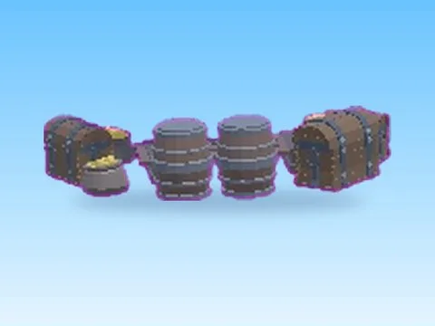
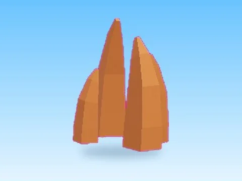
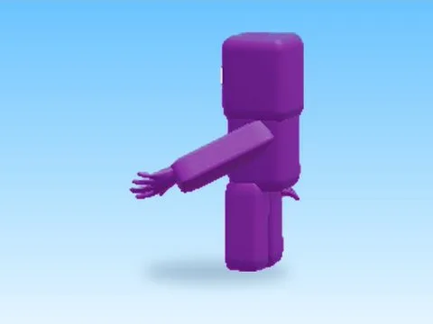

# Divers

Sous-catégorie de [Pets & meshes](../Pets%20&%20meshes.md) · **8 éléments**

| Aperçu | Élément | Infos |
| --- | --- | --- |
|  | [Blackbeard Stuff · Pet Pharmica](Blackbeard%20Stuff%20%C2%B7%20Pet%20Pharmica.md) | Modèle en MeshParts · 6 Parts · 18 MeshParts |
|  | [Cube · Mining Masters](Cube%20%C2%B7%20Mining%20Masters.md) | Modèle en MeshParts · 1 MeshPart |
|  | [Green · Cashgrab Bridge](Green%20%C2%B7%20Cashgrab%20Bridge.md) | Modèle en MeshParts · 11 Parts · 57 MeshParts |
|  | [Panel · First Donations](Panel%20%C2%B7%20First%20Donations.md) | Modèle en MeshParts · 16 Parts · 31 MeshParts |
|  | [Protection · Punch Simulator](Protection%20%C2%B7%20Punch%20Simulator.md) | Modèle en MeshParts · 1 MeshPart |
|  | [Radioactive Mining Site · Punch Simulator](Radioactive%20Mining%20Site%20%C2%B7%20Punch%20Simulator.md) | Modèle en MeshParts · 8 Parts · 10 MeshParts |
|  | [Return · Pet Pharmica](Return%20%C2%B7%20Pet%20Pharmica.md) | Modèle en MeshParts · 5 MeshParts |
|  | [Violet · Cashgrab Bridge](Violet%20%C2%B7%20Cashgrab%20Bridge.md) | Modèle en MeshParts · 2 Parts · 8 MeshParts |
