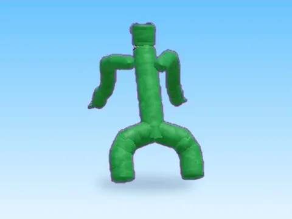

# Green · Cashgrab Bridge

Modèle en MeshParts « Green » (Cashgrab Bridge). Aperçu rendu dans Roblox Studio avec ses vraies textures.

- **Catégorie** : [Pets & meshes](../Pets%20&%20meshes.md)
- **Sous-catégorie** : [Divers](Divers%20%28Pets%20&%20meshes%29.md)
- **Type** : Modèle en MeshParts
- **Contenu** : 11 Parts · 57 MeshParts
- **Jeu d'origine** : Cashgrab Bridge
- **Fichier source** : `Assets/models/ByType/Misc/CashgrabBridge_Green.rbxm` (dans le vault)
