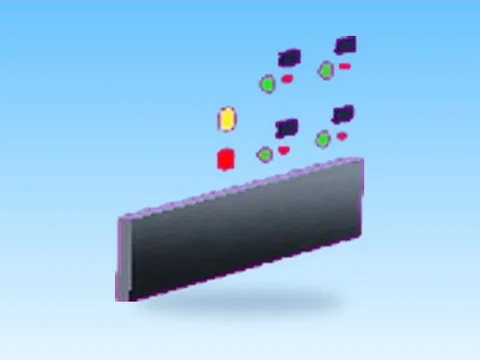

# Panel · First Donations

Modèle en MeshParts « Panel » (First Donations). Aperçu rendu dans Roblox Studio avec ses vraies textures.

- **Catégorie** : [Pets & meshes](../Pets%20&%20meshes.md)
- **Sous-catégorie** : [Divers](Divers%20%28Pets%20&%20meshes%29.md)
- **Type** : Modèle en MeshParts
- **Contenu** : 16 Parts · 31 MeshParts
- **Jeu d'origine** : First Donations
- **Fichier source** : `Assets/models/ByType/Misc/FirstDonations_Panel.rbxm` (dans le vault)
