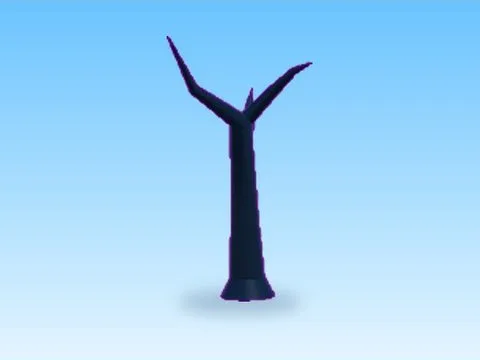

# Dead Tree · +1 Health Every Second

Modèle en MeshParts « Dead Tree » (+1 Health Every Second). Aperçu rendu dans Roblox Studio avec ses vraies textures.

- **Catégorie** : [Pets & meshes](../Pets%20&%20meshes.md)
- **Sous-catégorie** : [Décor](D%C3%A9cor%20%28Pets%20&%20meshes%29.md)
- **Type** : Modèle en MeshParts
- **Contenu** : 1 MeshPart
- **Jeu d'origine** : +1 Health Every Second
- **Fichier source** : `Assets/models/ByType/Decor_Props/1HealthEverySecond_DeadTree.rbxm` (dans le vault)
