# Décor

Sous-catégorie de [Pets & meshes](../Pets%20%26%20meshes.md) · **122 éléments**

| Aperçu | Élément | Infos |
| --- | --- | --- |
|  | [1Spawn Model · Pet Pharmica](1Spawn%20Model%20%C2%B7%20Pet%20Pharmica%20%C2%B7%20D%C3%A9cor.md) | Modèle en MeshParts · 46 MeshParts |
|  | [1Spawn Model 2 · Pet Pharmica](1Spawn%20Model%202%20%C2%B7%20Pet%20Pharmica.md) | Modèle en MeshParts · 2 Parts · 16 MeshParts |
|  | [5Winter · Rebirth Champions X](5Winter%20%C2%B7%20Rebirth%20Champions%20X.md) | Modèle en MeshParts · 10 MeshParts |
| 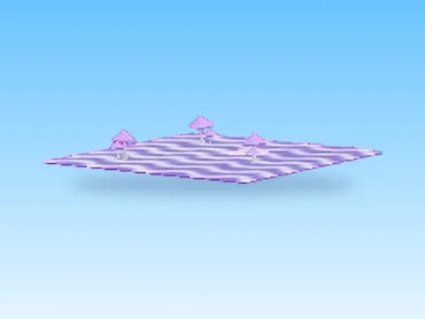 | [9Magic · Rebirth Champions X](9Magic%20%C2%B7%20Rebirth%20Champions%20X.md) | Modèle en MeshParts · 2 Parts · 21 MeshParts |
| 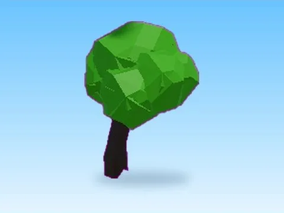 | [Arbol · First Donations](Arbol%20%C2%B7%20First%20Donations.md) | Modèle en MeshParts · 7 MeshParts |
|  | [Arrow · Punch Simulator](Arrow%20%C2%B7%20Punch%20Simulator.md) | Modèle en MeshParts · 1 MeshPart |
| 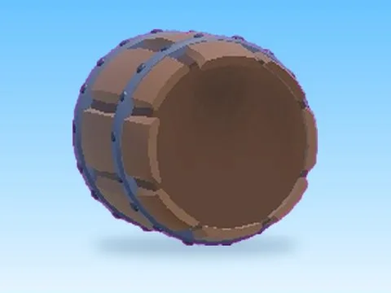 | [Barrel1 · Rebirth Champions X](Barrel1%20%C2%B7%20Rebirth%20Champions%20X.md) | Modèle en MeshParts · 5 MeshParts |
|  | [Basic Tree01 · Rebirth Champions X](Basic%20Tree01%20%C2%B7%20Rebirth%20Champions%20X.md) | Modèle en MeshParts · 3 MeshParts |
| 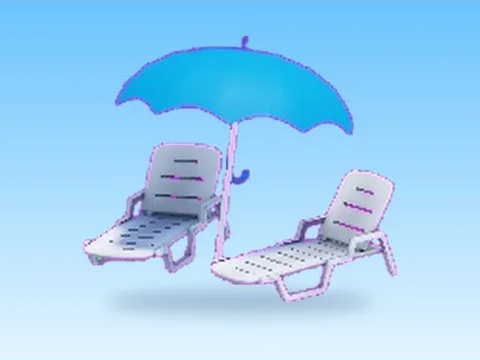 | [Beach Set · Billionaire Tycoon](Beach%20Set%20%C2%B7%20Billionaire%20Tycoon.md) | Modèle en MeshParts · 1 Part · 3 MeshParts |
| 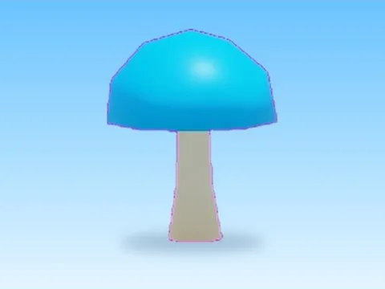 | [Blue Mush · Lib perso](Blue%20Mush%20%C2%B7%20Lib%20perso.md) | Modèle en MeshParts · 2 MeshParts |
| 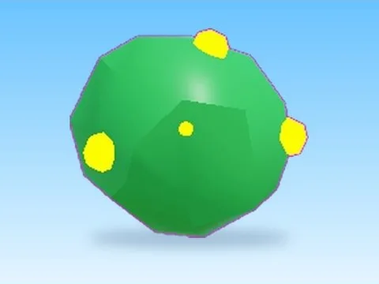 | [Bush · Pet Pharmica](Bush%20%C2%B7%20Pet%20Pharmica.md) | Modèle en MeshParts · 2 MeshParts |
| 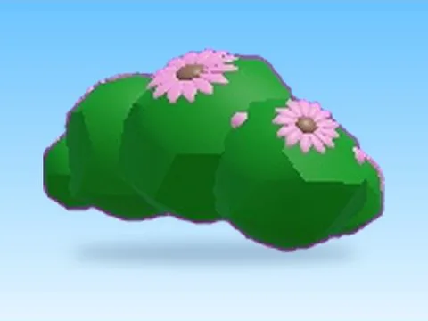 | [Bush2 · Rebirth Champions X](Bush2%20%C2%B7%20Rebirth%20Champions%20X.md) | Modèle en MeshParts · 4 MeshParts |
| 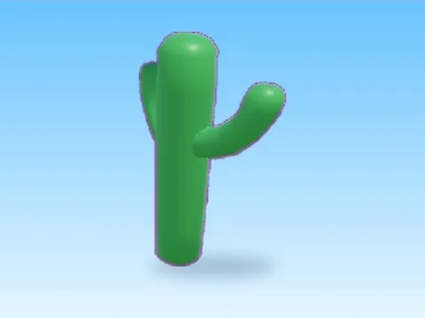 | [Cactus · +1 Health Every Second](Cactus%20%C2%B7%20%2B1%20Health%20Every%20Second.md) | Modèle en MeshParts · 1 MeshPart |
| 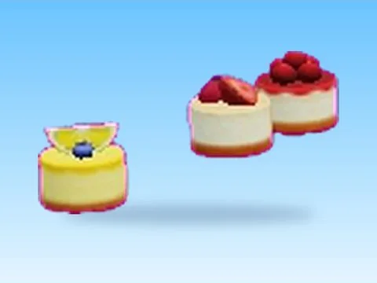 | [Cakes · Bakery Simulator](Cakes%20%C2%B7%20Bakery%20Simulator.md) | Modèle en MeshParts · 10 MeshParts |
|  | [Cartel Mini · First Donations](Cartel%20Mini%20%C2%B7%20First%20Donations.md) | Modèle en MeshParts · 28 MeshParts |
|  | [Cloud · Magnet Simulator 2](Cloud%20%C2%B7%20Magnet%20Simulator%202.md) | Modèle en MeshParts · 1 MeshPart |
|  | [Cloud Steps · Hatching Simulator](Cloud%20Steps%20%C2%B7%20Hatching%20Simulator.md) | Modèle en MeshParts · 21 MeshParts |
| 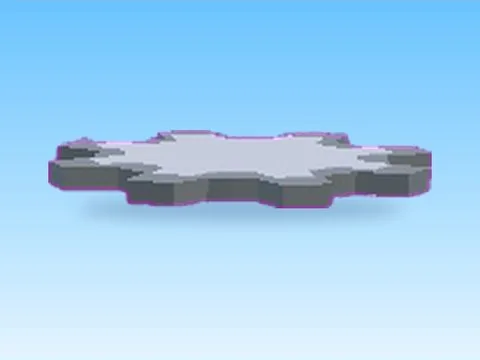 | [Cog Plat · Robot Simulator](Cog%20Plat%20%C2%B7%20Robot%20Simulator.md) | Modèle en MeshParts · 2 MeshParts |
|  | [Cookies · Bakery Simulator](Cookies%20%C2%B7%20Bakery%20Simulator.md) | Modèle en MeshParts · 9 MeshParts |
|  | [Crown · Punch Simulator](Crown%20%C2%B7%20Punch%20Simulator.md) | Modèle en MeshParts · 5 MeshParts |
| 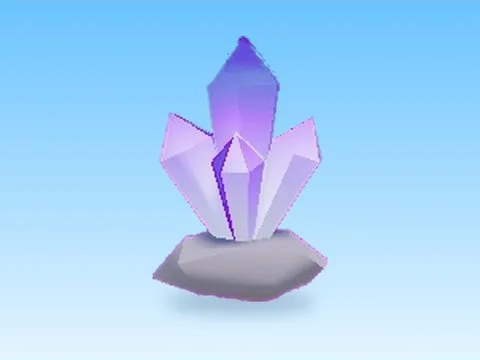 | [Crystal Cluster · Pet Pharmica](Crystal%20Cluster%20%C2%B7%20Pet%20Pharmica.md) | Modèle en MeshParts · 3 MeshParts |
| 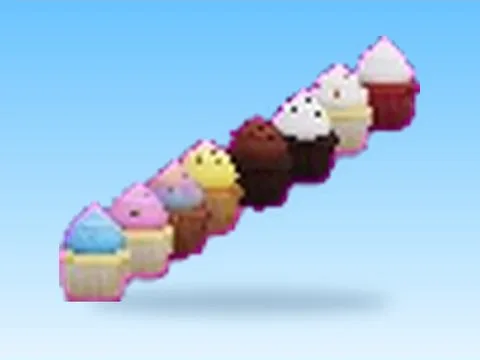 | [Cupcakes · Bakery Simulator](Cupcakes%20%C2%B7%20Bakery%20Simulator.md) | Modèle en MeshParts · 15 MeshParts |
|  | [Dead Tree · +1 Health Every Second](Dead%20Tree%20%C2%B7%20%2B1%20Health%20Every%20Second.md) | Modèle en MeshParts · 1 MeshPart |
| 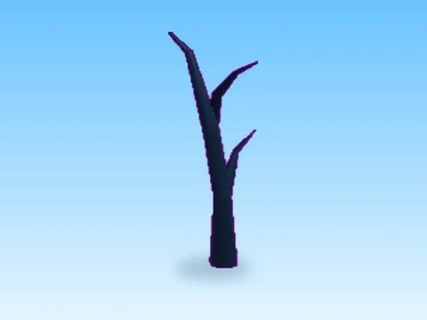 | [Dead Tree · Mining Masters](Dead%20Tree%20%C2%B7%20Mining%20Masters.md) | Modèle en MeshParts · 1 MeshPart |
| 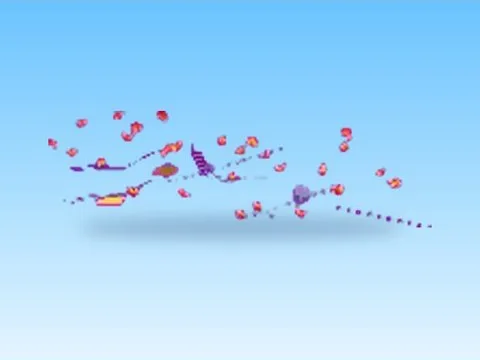 | [Decor · Rebirth Champions X](Decor%20%C2%B7%20Rebirth%20Champions%20X.md) | Modèle en MeshParts · 22 Parts · 443 MeshParts |
|  | [Desert Island · Tweeting Simulator](Desert%20Island%20%C2%B7%20Tweeting%20Simulator.md) | Modèle en MeshParts · 24 Parts · 17 MeshParts |
|  | [Dirt · Rebirth Champions X](Dirt%20%C2%B7%20Rebirth%20Champions%20X.md) | Modèle en MeshParts · 35 MeshParts |
| 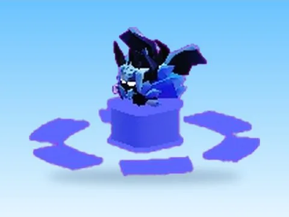 | [Discord Verification · Punch Simulator](Discord%20Verification%20%C2%B7%20Punch%20Simulator%20%C2%B7%20D%C3%A9cor.md) | Modèle en MeshParts · 5 MeshParts |
|  | [Display Model Bread · Bakery Simulator](Display%20Model%20Bread%20%C2%B7%20Bakery%20Simulator.md) | Modèle en MeshParts · 1 MeshPart |
| 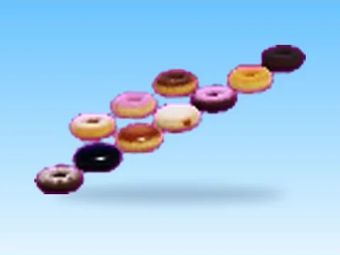 | [Donuts · Bakery Simulator](Donuts%20%C2%B7%20Bakery%20Simulator.md) | Modèle en MeshParts · 10 MeshParts |
|  | [Easter Model · Rebirth Champions X](Easter%20Model%20%C2%B7%20Rebirth%20Champions%20X.md) | Modèle en MeshParts · 26 MeshParts |
|  | [Easter Model 3 · Rebirth Champions X](Easter%20Model%203%20%C2%B7%20Rebirth%20Champions%20X.md) | Modèle en MeshParts · 1 Part · 22 MeshParts |
| 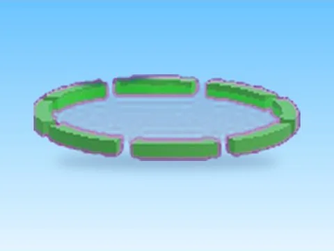 | [Easter Pass · Rebirth Champions X](Easter%20Pass%20%C2%B7%20Rebirth%20Champions%20X.md) | Modèle en MeshParts · 2 MeshParts |
| 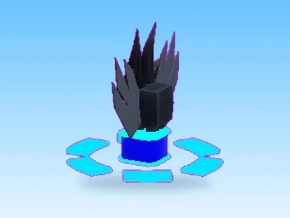 | [Electro Spirit · Punch Simulator](Electro%20Spirit%20%C2%B7%20Punch%20Simulator.md) | Modèle en MeshParts · 4 MeshParts |
|  | [Enchanting Station · Hatching Simulator](Enchanting%20Station%20%C2%B7%20Hatching%20Simulator.md) | Modèle en MeshParts · 8 MeshParts |
|  | [Exotic · Bakery Simulator](Exotic%20%C2%B7%20Bakery%20Simulator.md) | Modèle en MeshParts · 17 MeshParts |
| 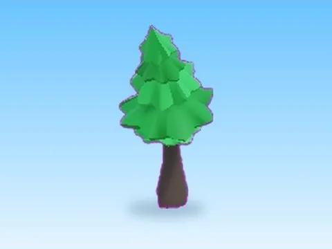 | [Fantasy Pine · Pet Pharmica](Fantasy%20Pine%20%C2%B7%20Pet%20Pharmica.md) | Modèle en MeshParts · 6 MeshParts |
| 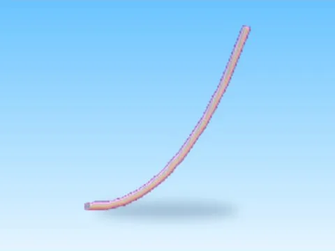 | [Fiber Rope · Rebirth Champions X](Fiber%20Rope%20%C2%B7%20Rebirth%20Champions%20X.md) | Modèle en MeshParts · 11 MeshParts |
| 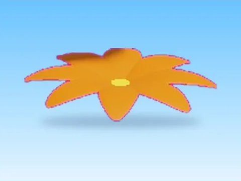 | [Flower01 · Rebirth Champions X](Flower01%20%C2%B7%20Rebirth%20Champions%20X.md) | Modèle en MeshParts · 2 MeshParts |
| 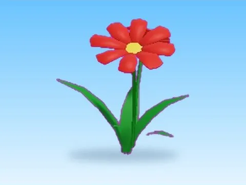 | [Flower01 2 · Rebirth Champions X](Flower01%202%20%C2%B7%20Rebirth%20Champions%20X.md) | Modèle en MeshParts · 4 MeshParts |
| 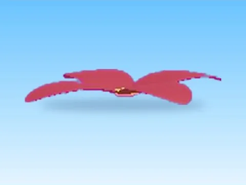 | [Flower02 · Rebirth Champions X](Flower02%20%C2%B7%20Rebirth%20Champions%20X.md) | Modèle en MeshParts · 2 MeshParts |
|  | [Flowers Model · Pet Pharmica](Flowers%20Model%20%C2%B7%20Pet%20Pharmica.md) | Modèle en MeshParts · 3 MeshParts |
|  | [Fountain · Lib perso](Fountain%20%C2%B7%20Lib%20perso.md) | Modèle en MeshParts · 1 MeshPart |
| 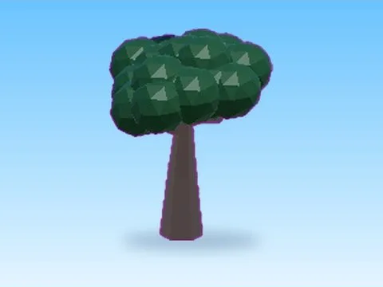 | [Garbage Tree · Tweeting Simulator](Garbage%20Tree%20%C2%B7%20Tweeting%20Simulator.md) | Modèle en MeshParts · 2 MeshParts |
| 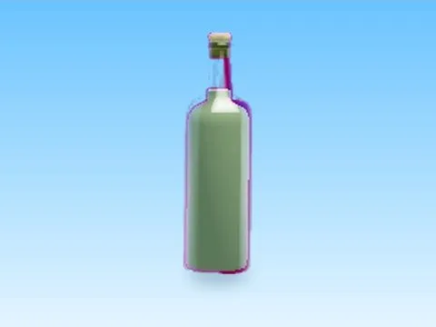 | [Grapejuicebottleremastered · First Donations](Grapejuicebottleremastered%20%C2%B7%20First%20Donations.md) | Modèle en MeshParts · 3 MeshParts |
| 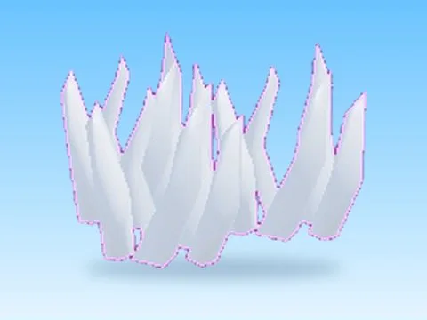 | [Grass · Hatching Simulator](Grass%20%C2%B7%20Hatching%20Simulator.md) | Modèle en MeshParts · 3 MeshParts |
|  | [Grass · Lib perso](Grass%20%C2%B7%20Lib%20perso.md) | Modèle en MeshParts · 1 MeshPart |
|  | [Grass · Magnet Simulator 2](Grass%20%C2%B7%20Magnet%20Simulator%202.md) | Modèle en MeshParts · 301 Parts · 62 MeshParts |
|  | [Grass · Rebirth Champions X](Grass%20%C2%B7%20Rebirth%20Champions%20X.md) | Modèle en MeshParts · 49 MeshParts |
| 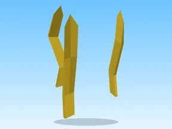 | [Grass · Tweeting Simulator](Grass%20%C2%B7%20Tweeting%20Simulator.md) | Modèle en MeshParts · 47 MeshParts |
|  | [Grass Hill · Tapping Lords](Grass%20Hill%20%C2%B7%20Tapping%20Lords.md) | Modèle en MeshParts · 2 MeshParts |
|  | [Ground Grass Part · Lib perso](Ground%20Grass%20Part%20%C2%B7%20Lib%20perso.md) | Modèle en MeshParts · 1 MeshPart |
|  | [Hill · Hatching Simulator](Hill%20%C2%B7%20Hatching%20Simulator.md) | Modèle en MeshParts · 2 MeshParts |
|  | [Hill With Quicksilver · Pet Pharmica](Hill%20With%20Quicksilver%20%C2%B7%20Pet%20Pharmica.md) | Modèle en MeshParts · 10 Parts · 9 MeshParts |
| 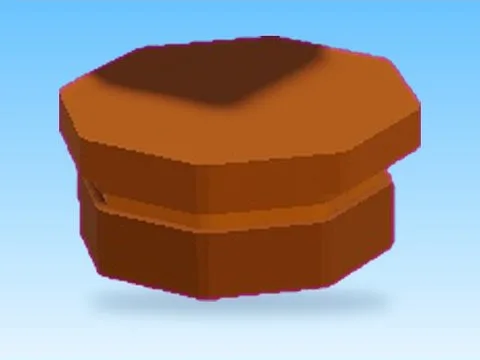 | [Hongo Naranja · First Donations](Hongo%20Naranja%20%C2%B7%20First%20Donations.md) | Modèle en MeshParts · 3 MeshParts |
| 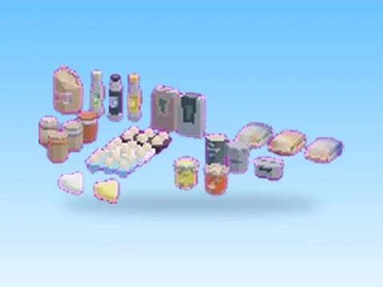 | [Ingredients · Bakery Simulator](Ingredients%20%C2%B7%20Bakery%20Simulator.md) | Modèle en MeshParts · 26 MeshParts |
| 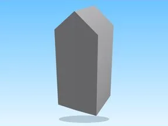 | [Ingredients OLD · Bakery Simulator](Ingredients%20OLD%20%C2%B7%20Bakery%20Simulator.md) | Modèle en MeshParts · 6 MeshParts |
| 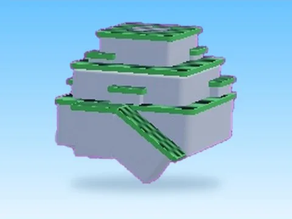 | [King Hill · Robot Simulator](King%20Hill%20%C2%B7%20Robot%20Simulator.md) | Modèle en MeshParts · 2 Parts · 24 MeshParts |
| 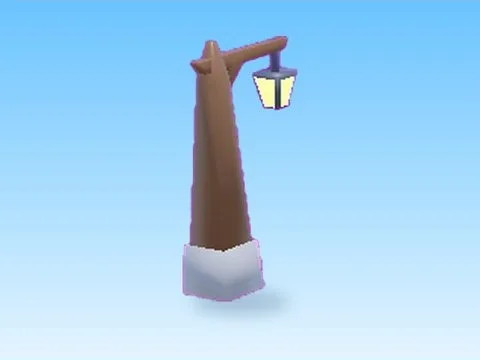 | [Lamp Post · Robot Simulator](Lamp%20Post%20%C2%B7%20Robot%20Simulator.md) | Modèle en MeshParts · 4 MeshParts |
|  | [Layered Island Platform · Pet Pharmica](Layered%20Island%20Platform%20%C2%B7%20Pet%20Pharmica.md) | Modèle en MeshParts · 2 MeshParts |
| 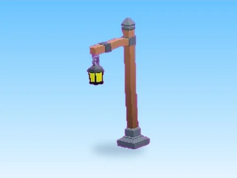 | [Light Post · Lib perso](Light%20Post%20%C2%B7%20Lib%20perso.md) | Modèle en MeshParts · 4 MeshParts |
| 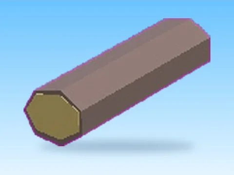 | [Log · Tapping Lords](Log%20%C2%B7%20Tapping%20Lords.md) | Modèle en MeshParts · 2 MeshParts |
|  | [Make Rainbow · Pet Pharmica](Make%20Rainbow%20%C2%B7%20Pet%20Pharmica.md) | Modèle en MeshParts · 3 Parts · 44 MeshParts |
| 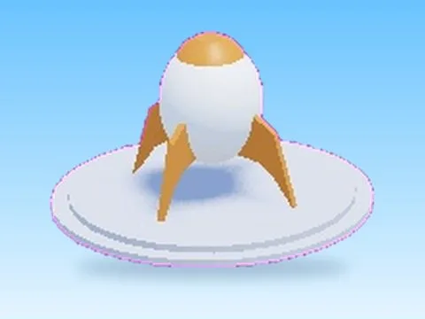 | [Mars Rocket · Hatching Simulator](Mars%20Rocket%20%C2%B7%20Hatching%20Simulator.md) | Modèle en MeshParts · 8 MeshParts |
|  | [Moon Tree · Hatching Simulator](Moon%20Tree%20%C2%B7%20Hatching%20Simulator.md) | Modèle en MeshParts · 3 MeshParts |
| 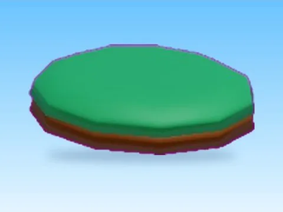 | [Mound · Tapping Lords](Mound%20%C2%B7%20Tapping%20Lords.md) | Modèle en MeshParts · 2 MeshParts |
| 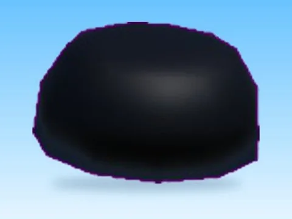 | [Mountain · Tapping Lords](Mountain%20%C2%B7%20Tapping%20Lords.md) | Modèle en MeshParts · 2 MeshParts |
|  | [Mountain · Tweeting Simulator](Mountain%20%C2%B7%20Tweeting%20Simulator.md) | Modèle en MeshParts · 2 MeshParts |
| 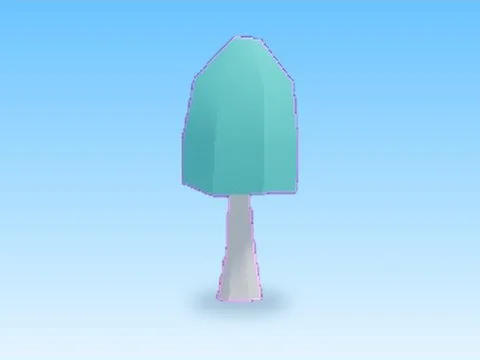 | [Mushroom · Rebirth Champions X](Mushroom%20%C2%B7%20Rebirth%20Champions%20X.md) | Modèle en MeshParts · 2 MeshParts |
| 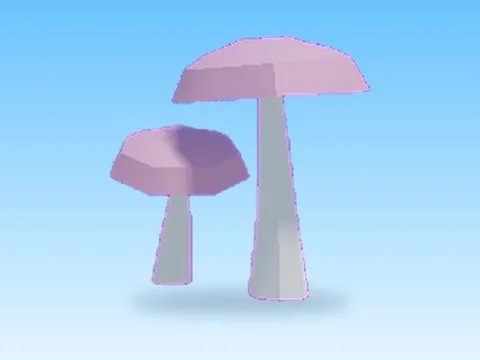 | [Mushroom04 · Rebirth Champions X](Mushroom04%20%C2%B7%20Rebirth%20Champions%20X.md) | Modèle en MeshParts · 4 MeshParts |
| 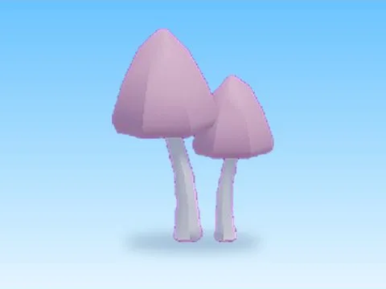 | [Mushroom06 · Rebirth Champions X](Mushroom06%20%C2%B7%20Rebirth%20Champions%20X.md) | Modèle en MeshParts · 4 MeshParts |
| 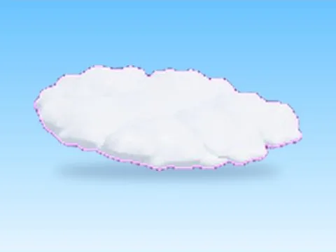 | [Nubes · First Donations](Nubes%20%C2%B7%20First%20Donations.md) | Modèle en MeshParts · 7 MeshParts |
| 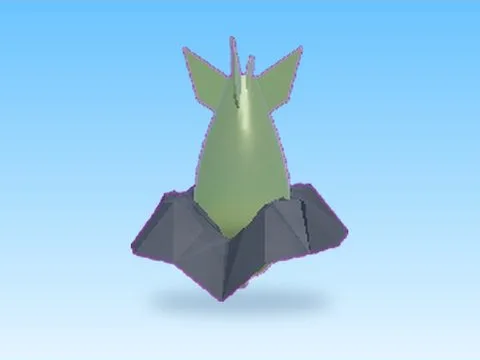 | [Nuke · Bakery Simulator](Nuke%20%C2%B7%20Bakery%20Simulator.md) | Modèle en MeshParts · 2 MeshParts |
|  | [Nuke · First Donations](Nuke%20%C2%B7%20First%20Donations.md) | Modèle en MeshParts · 2 MeshParts |
| 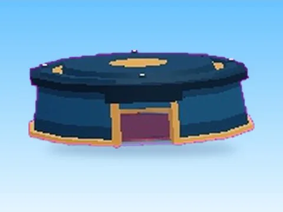 | [Nuke Platform · First Donations](Nuke%20Platform%20%C2%B7%20First%20Donations.md) | Modèle en MeshParts · 1 Part · 20 MeshParts |
| 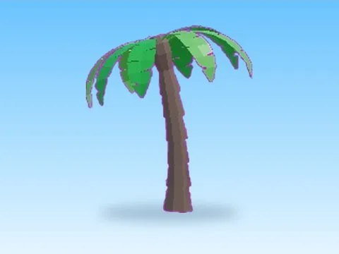 | [Palm Tree · Glass Bridge](Palm%20Tree%20%C2%B7%20Glass%20Bridge.md) | Modèle en MeshParts · 9 MeshParts |
| 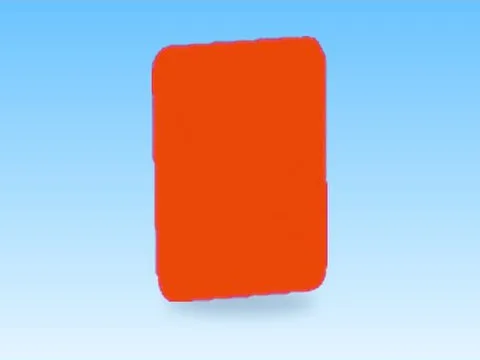 | [Phone · Tweeting Simulator](Phone%20%C2%B7%20Tweeting%20Simulator.md) | Modèle en MeshParts · 2 MeshParts |
|  | [Piedra Roja · First Donations](Piedra%20Roja%20%C2%B7%20First%20Donations.md) | Modèle en MeshParts · 3 MeshParts |
| 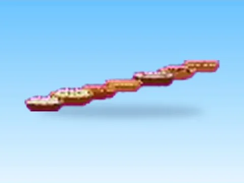 | [Pies · Bakery Simulator](Pies%20%C2%B7%20Bakery%20Simulator.md) | Modèle en MeshParts · 12 MeshParts |
| 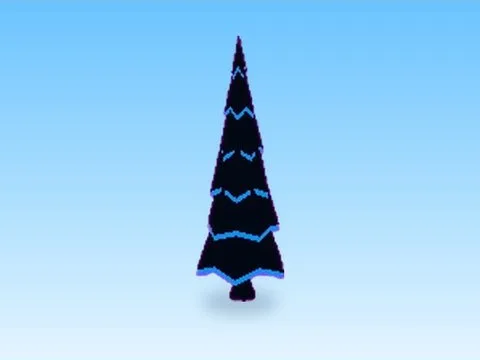 | [Pine Tree02 · Rebirth Champions X](Pine%20Tree02%20%C2%B7%20Rebirth%20Champions%20X.md) | Modèle en MeshParts · 3 MeshParts |
|  | [Playground · Cashgrab Bridge](Playground%20%C2%B7%20Cashgrab%20Bridge.md) | Modèle en MeshParts · 530 Parts · 51 MeshParts |
| 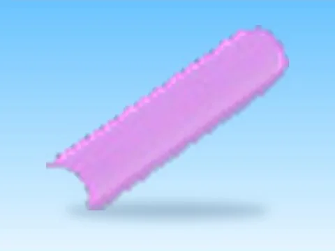 | [Random Models Model · Mining Masters](Random%20Models%20Model%20%C2%B7%20Mining%20Masters.md) | Modèle en MeshParts · 8 MeshParts |
| 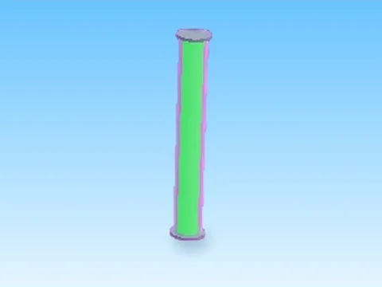 | [Random Models Model 2 · Mining Masters](Random%20Models%20Model%202%20%C2%B7%20Mining%20Masters.md) | Modèle en MeshParts · 2 Parts · 2 MeshParts |
| 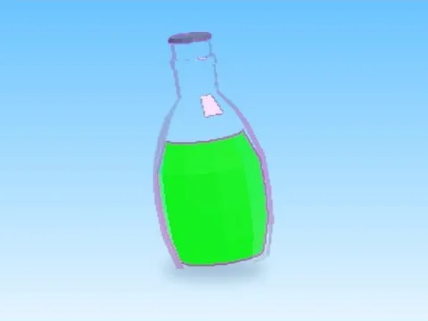 | [Random Models Model 4 · Mining Masters](Random%20Models%20Model%204%20%C2%B7%20Mining%20Masters.md) | Modèle en MeshParts · 3 MeshParts |
|  | [Random Models Model 5 · Mining Masters](Random%20Models%20Model%205%20%C2%B7%20Mining%20Masters.md) | Modèle en MeshParts · 5 MeshParts |
|  | [Random Models Model 6 · Mining Masters](Random%20Models%20Model%206%20%C2%B7%20Mining%20Masters.md) | Modèle en MeshParts · 32 MeshParts |
|  | [Rock · Lib perso](Rock%20%C2%B7%20Lib%20perso.md) | Modèle en MeshParts · 1 MeshPart |
|  | [Rocks · +1 Health Every Second](Rocks%20%C2%B7%20%2B1%20Health%20Every%20Second.md) | Modèle en MeshParts · 3 MeshParts |
|  | [Rocks · Hatching Simulator](Rocks%20%C2%B7%20Hatching%20Simulator.md) | Modèle en MeshParts · 11 MeshParts |
|  | [Rocks · Rebirth Champions X](Rocks%20%C2%B7%20Rebirth%20Champions%20X.md) | Modèle en MeshParts · 361 MeshParts |
|  | [Rocks · Robot Simulator](Rocks%20%C2%B7%20Robot%20Simulator.md) | Modèle en MeshParts · 69 MeshParts |
|  | [Rocks · Tapping Lords](Rocks%20%C2%B7%20Tapping%20Lords.md) | Modèle en MeshParts · 19 MeshParts |
|  | [Savana Tree · Tweeting Simulator](Savana%20Tree%20%C2%B7%20Tweeting%20Simulator.md) | Modèle en MeshParts · 2 MeshParts |
|  | [Shinies · Rebirth Champions X](Shinies%20%C2%B7%20Rebirth%20Champions%20X.md) | Modèle en MeshParts · 50 MeshParts |
|  | [Spawn Items · Robot Simulator](Spawn%20Items%20%C2%B7%20Robot%20Simulator.md) | Modèle en MeshParts · 21 MeshParts |
|  | [Spike · Mining Masters](Spike%20%C2%B7%20Mining%20Masters.md) | Modèle en MeshParts · 1 MeshPart |
|  | [Stump · Rebirth Champions X](Stump%20%C2%B7%20Rebirth%20Champions%20X.md) | Modèle en MeshParts · 2 MeshParts |
|  | [Suffixes · Rebirth Champions X](Suffixes%20%C2%B7%20Rebirth%20Champions%20X.md) | Modèle en MeshParts · 2 Parts · 2 MeshParts |
|  | [Sweetbread · Bakery Simulator](Sweetbread%20%C2%B7%20Bakery%20Simulator.md) | Modèle en MeshParts · 1 MeshPart |
|  | [Swing Set · Glass Bridge](Swing%20Set%20%C2%B7%20Glass%20Bridge.md) | Modèle en MeshParts · 9 Parts · 12 MeshParts |
|  | [Table · Training Simulator](Table%20%C2%B7%20Training%20Simulator.md) | Modèle en MeshParts · 6 MeshParts |
|  | [Three DText Object · Rebirth Champions X](Three%20DText%20Object%20%C2%B7%20Rebirth%20Champions%20X.md) | Modèle en MeshParts · 4 MeshParts |
|  | [Three DText Object 2 · Rebirth Champions X](Three%20DText%20Object%202%20%C2%B7%20Rebirth%20Champions%20X.md) | Modèle en MeshParts · 5 MeshParts |
|  | [Top · Hatching Simulator](Top%20%C2%B7%20Hatching%20Simulator.md) | Modèle en MeshParts · 71 MeshParts |
|  | [Training Areas 2 · Punch Simulator](Training%20Areas%202%20%C2%B7%20Punch%20Simulator.md) | Modèle en MeshParts · 2 Parts · 28 MeshParts |
|  | [Training Areas 3 · Punch Simulator](Training%20Areas%203%20%C2%B7%20Punch%20Simulator.md) | Modèle en MeshParts · 1 Part · 5 MeshParts |
|  | [Training Areas 4 · Punch Simulator](Training%20Areas%204%20%C2%B7%20Punch%20Simulator.md) | Modèle en MeshParts · 28 MeshParts |
|  | [Training Areas 6 · Punch Simulator](Training%20Areas%206%20%C2%B7%20Punch%20Simulator.md) | Modèle en MeshParts · 30 MeshParts |
|  | [Tray · Bakery Simulator](Tray%20%C2%B7%20Bakery%20Simulator.md) | Modèle en MeshParts · 1 MeshPart |
|  | [Tree · +1 Health Every Second](Tree%20%C2%B7%20%2B1%20Health%20Every%20Second.md) | Modèle en MeshParts · 4 MeshParts |
|  | [Tree · Pet Pharmica](Tree%20%C2%B7%20Pet%20Pharmica.md) | Modèle en MeshParts · 7 MeshParts |
|  | [Tree · Tapping Lords](Tree%20%C2%B7%20Tapping%20Lords.md) | Modèle en MeshParts · 5 MeshParts |
|  | [Tree 2 · Tapping Lords](Tree%202%20%C2%B7%20Tapping%20Lords.md) | Modèle en MeshParts · 2 MeshParts |
|  | [Tree Of Life · Tweeting Simulator](Tree%20Of%20Life%20%C2%B7%20Tweeting%20Simulator.md) | Modèle en MeshParts · 21 MeshParts |
|  | [Tree2 · Robot Simulator](Tree2%20%C2%B7%20Robot%20Simulator.md) | Modèle en MeshParts · 2 MeshParts |
|  | [Unique · Tweeting Simulator](Unique%20%C2%B7%20Tweeting%20Simulator.md) | Modèle en MeshParts · 10 MeshParts |
|  | [Unused · Mining Masters](Unused%20%C2%B7%20Mining%20Masters.md) | Modèle en MeshParts · 44 MeshParts |
|  | [Water Assets · Tapping Lords](Water%20Assets%20%C2%B7%20Tapping%20Lords.md) | Modèle en MeshParts · 17 MeshParts |
|  | [Well · Rebirth Champions X](Well%20%C2%B7%20Rebirth%20Champions%20X.md) | Modèle en MeshParts · 6 Parts · 31 MeshParts |
|  | [Wheel · Cashgrab Bridge](Wheel%20%C2%B7%20Cashgrab%20Bridge.md) | Modèle en MeshParts · 4 MeshParts |
|  | [Win · +1 Jump Every Second](Win%20%C2%B7%20%2B1%20Jump%20Every%20Second.md) | Modèle en MeshParts · 2 MeshParts |
|  | [Woda · Rebirth Champions X](Woda%20%C2%B7%20Rebirth%20Champions%20X.md) | Modèle en MeshParts · 3 MeshParts |
