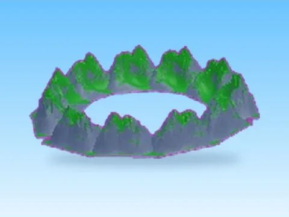

# Easter Model 3 · Rebirth Champions X

Modèle en MeshParts « Easter Model 3 » (Rebirth Champions X). Aperçu rendu dans Roblox Studio avec ses vraies textures.

- **Catégorie** : [Pets & meshes](../Pets%20&%20meshes.md)
- **Sous-catégorie** : [Décor](D%C3%A9cor%20%28Pets%20&%20meshes%29.md)
- **Type** : Modèle en MeshParts
- **Contenu** : 1 Part · 22 MeshParts
- **Jeu d'origine** : Rebirth Champions X
- **Fichier source** : `Assets/models/ByType/Decor_Props/RebirthChampionsX_Easter_Model_3.rbxm` (dans le vault)
