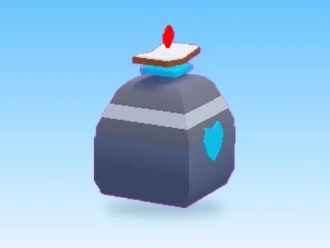

# Enchanting Station · Hatching Simulator

Modèle en MeshParts « Enchanting Station » (Hatching Simulator). Aperçu rendu dans Roblox Studio avec ses vraies textures.

- **Catégorie** : [Pets & meshes](../Pets%20&%20meshes.md)
- **Sous-catégorie** : [Décor](D%C3%A9cor%20%28Pets%20&%20meshes%29.md)
- **Type** : Modèle en MeshParts
- **Contenu** : 8 MeshParts
- **Jeu d'origine** : Hatching Simulator
- **Fichier source** : `Assets/models/ByType/Decor_Props/HatchingSim_EnchantingStation.rbxm` (dans le vault)
