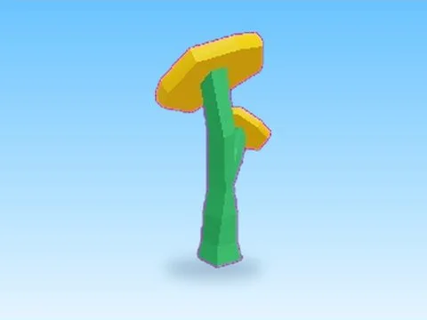

# Flowers Model · Pet Pharmica

Modèle en MeshParts « Flowers Model » (Pet Pharmica). Aperçu rendu dans Roblox Studio avec ses vraies textures.

- **Catégorie** : [Pets & meshes](../Pets%20&%20meshes.md)
- **Sous-catégorie** : [Décor](D%C3%A9cor%20%28Pets%20&%20meshes%29.md)
- **Type** : Modèle en MeshParts
- **Contenu** : 3 MeshParts
- **Jeu d'origine** : Pet Pharmica
- **Fichier source** : `Assets/models/ByType/Decor_Props/PetPharmica_Flowers_Model.rbxm` (dans le vault)
