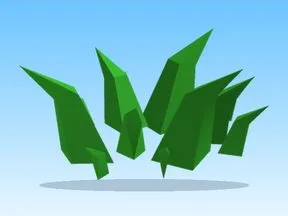

# Grass · Rebirth Champions X

Modèle en MeshParts « Grass » (Rebirth Champions X). Aperçu : forme du mesh principal (sans texture).

- **Catégorie** : [Pets & meshes](../Pets%20&%20meshes.md)
- **Sous-catégorie** : [Décor](D%C3%A9cor%20%28Pets%20&%20meshes%29.md)
- **Type** : Modèle en MeshParts
- **Contenu** : 49 MeshParts
- **Jeu d'origine** : Rebirth Champions X
- **Fichier source** : `Assets/models/ByType/Decor_Props/RebirthChampionsX_Grass.rbxm` (dans le vault)
