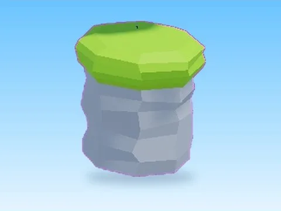

# Hill With Quicksilver · Pet Pharmica

Modèle en MeshParts « Hill With Quicksilver » (Pet Pharmica). Aperçu rendu dans Roblox Studio avec ses vraies textures.

- **Catégorie** : [Pets & meshes](../Pets%20&%20meshes.md)
- **Sous-catégorie** : [Décor](D%C3%A9cor%20%28Pets%20&%20meshes%29.md)
- **Type** : Modèle en MeshParts
- **Contenu** : 10 Parts · 9 MeshParts
- **Jeu d'origine** : Pet Pharmica
- **Fichier source** : `models/ByType/Decor_Props/PetPharmica_HillWithQuicksilver.rbxm` (dans ta bibliothèque `rblx\lib`)
