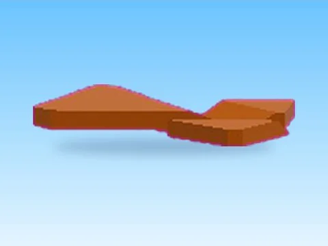

# Piedra Roja · First Donations

Modèle en MeshParts « Piedra Roja » (First Donations). Aperçu rendu dans Roblox Studio avec ses vraies textures.

- **Catégorie** : [Pets & meshes](../Pets%20%26%20meshes.md)
- **Sous-catégorie** : [Décor](D%C3%A9cor%20%28Pets%20%26%20meshes%29.md)
- **Type** : Modèle en MeshParts
- **Contenu** : 3 MeshParts
- **Jeu d'origine** : First Donations
- **Fichier source** : `models/ByType/Decor_Props/FirstDonations_PiedraRoja.rbxm` (dans ta bibliothèque `rblx\lib`)
