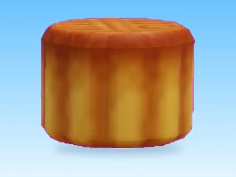

# Sweetbread · Bakery Simulator

Modèle en MeshParts « Sweetbread » (Bakery Simulator). Aperçu rendu dans Roblox Studio avec ses vraies textures.

- **Catégorie** : [Pets & meshes](../Pets%20%26%20meshes.md)
- **Sous-catégorie** : [Décor](D%C3%A9cor%20%28Pets%20%26%20meshes%29.md)
- **Type** : Modèle en MeshParts
- **Contenu** : 1 MeshPart
- **Jeu d'origine** : Bakery Simulator
- **Fichier source** : `models/ByType/Decor_Props/BakerySim_Sweetbread.rbxm` (dans ta bibliothèque `rblx\lib`)
