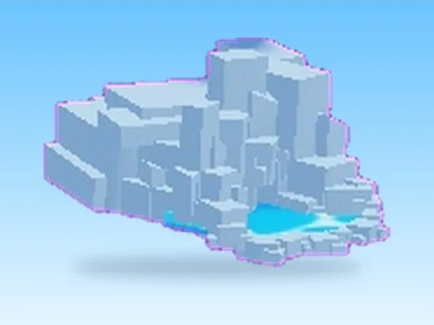

# Training Areas 2 · Punch Simulator

Modèle en MeshParts « Training Areas 2 » (Punch Simulator). Aperçu rendu dans Roblox Studio avec ses vraies textures.

- **Catégorie** : [Pets & meshes](../Pets%20&%20meshes.md)
- **Sous-catégorie** : [Décor](D%C3%A9cor%20%28Pets%20&%20meshes%29.md)
- **Type** : Modèle en MeshParts
- **Contenu** : 2 Parts · 28 MeshParts
- **Jeu d'origine** : Punch Simulator
- **Fichier source** : `Assets/models/ByType/Decor_Props/PunchSim_TrainingAreas_2.rbxm` (dans le vault)
