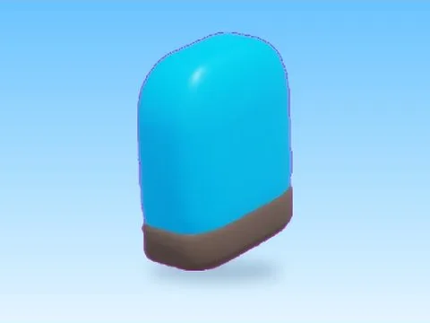

# Basic · Tweeting Simulator

Modèle en MeshParts « Basic » (Tweeting Simulator). Aperçu rendu dans Roblox Studio avec ses vraies textures.

- **Catégorie** : [Pets & meshes](../Pets%20%26%20meshes.md)
- **Sous-catégorie** : [Gadgets](Gadgets%20%28Pets%20%26%20meshes%29.md)
- **Type** : Modèle en MeshParts
- **Contenu** : 1 Part · 4 MeshParts
- **Jeu d'origine** : Tweeting Simulator
- **Fichier source** : `models/ByType/Gear_Gadgets/TweetingSim_Basic.rbxm` (dans ta bibliothèque `rblx\lib`)
