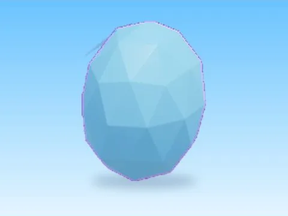

# Cloud · Tweeting Simulator

Modèle en MeshParts « Cloud » (Tweeting Simulator). Aperçu rendu dans Roblox Studio avec ses vraies textures.

- **Catégorie** : [Pets & meshes](../Pets%20&%20meshes.md)
- **Sous-catégorie** : [Gadgets](Gadgets%20%28Pets%20&%20meshes%29.md)
- **Type** : Modèle en MeshParts
- **Contenu** : 1 Part · 2 MeshParts
- **Jeu d'origine** : Tweeting Simulator
- **Fichier source** : `Assets/models/ByType/Gear_Gadgets/TweetingSim_Cloud.rbxm` (dans le vault)
