# Gadgets

Sous-catégorie de [Pets & meshes](../Pets%20&%20meshes.md) · **20 éléments**

| Aperçu | Élément | Infos |
| --- | --- | --- |
|  | [Basic · Tweeting Simulator](Basic%20%C2%B7%20Tweeting%20Simulator.md) | Modèle en MeshParts · 1 Part · 4 MeshParts |
| 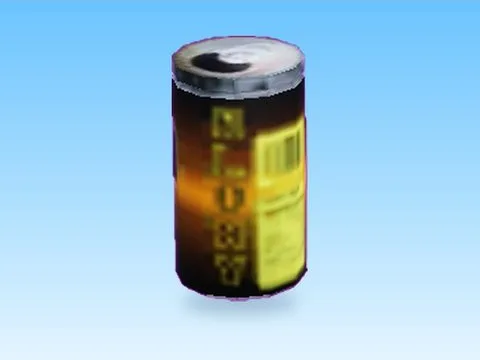 | [Bloxy Cola · +1 Health Every Second](Bloxy%20Cola%20%C2%B7%20+1%20Health%20Every%20Second.md) | Modèle en MeshParts · 1 MeshPart |
| 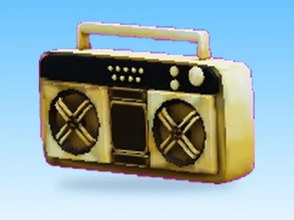 | [Boombox · +1 Jump Every Second](Boombox%20%C2%B7%20+1%20Jump%20Every%20Second.md) | Modèle en MeshParts · 1 MeshPart |
| 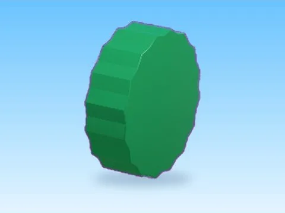 | [Bush · Tweeting Simulator](Bush%20%C2%B7%20Tweeting%20Simulator.md) | Modèle en MeshParts · 1 Part · 4 MeshParts |
| 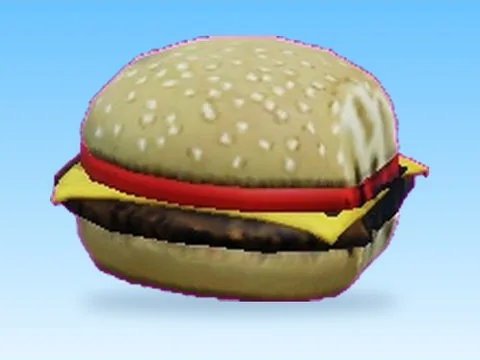 | [Cheezburger · Glass Bridge](Cheezburger%20%C2%B7%20Glass%20Bridge.md) | Modèle en MeshParts · 1 MeshPart |
|  | [Cloud · Tweeting Simulator](Cloud%20%C2%B7%20Tweeting%20Simulator.md) | Modèle en MeshParts · 1 Part · 2 MeshParts |
| 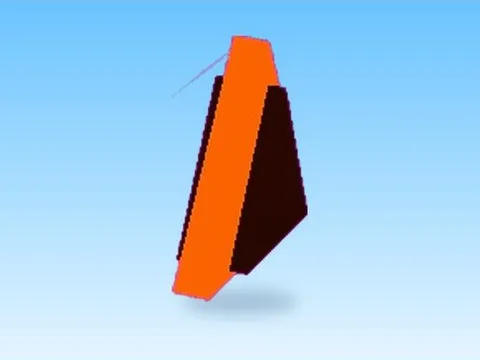 | [Fire Triangle · Tweeting Simulator](Fire%20Triangle%20%C2%B7%20Tweeting%20Simulator.md) | Modèle en MeshParts · 1 Part · 3 MeshParts |
| 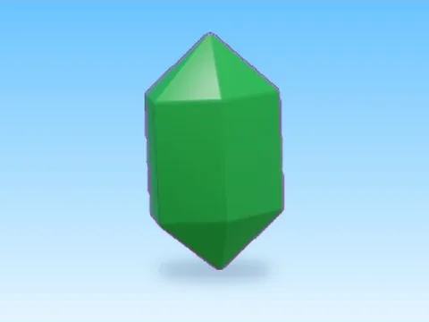 | [Gem · Tweeting Simulator](Gem%20%C2%B7%20Tweeting%20Simulator.md) | Modèle en MeshParts · 1 Part · 3 MeshParts |
| 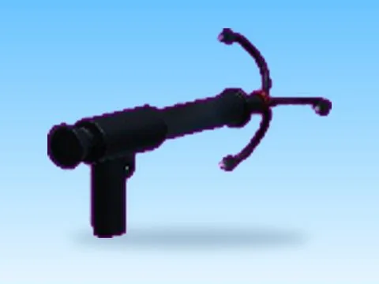 | [Grapple Hook · +1 Jump Every Second](Grapple%20Hook%20%C2%B7%20+1%20Jump%20Every%20Second.md) | Modèle en MeshParts · 1 MeshPart |
| 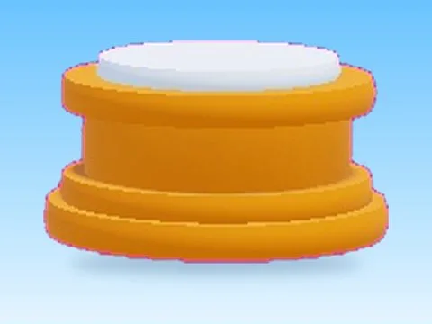 | [Grapple Hook 2 · +1 Jump Every Second](Grapple%20Hook%202%20%C2%B7%20+1%20Jump%20Every%20Second.md) | Modèle en MeshParts · 5 MeshParts |
| 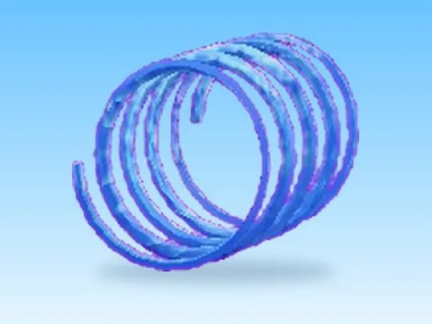 | [Gravity Coil · +1 Jump Every Second](Gravity%20Coil%20%C2%B7%20+1%20Jump%20Every%20Second.md) | Modèle en MeshParts · 1 MeshPart |
| 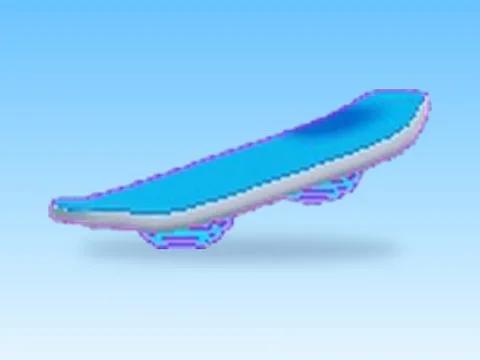 | [Hoverboard Model · +1 Jump Every Second](Hoverboard%20Model%20%C2%B7%20+1%20Jump%20Every%20Second.md) | Modèle en MeshParts · 5 MeshParts |
| 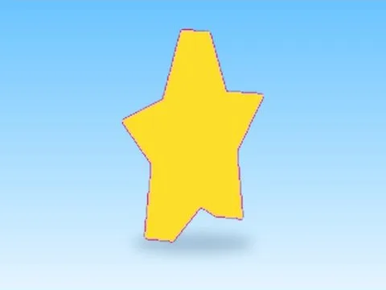 | [Infinity · Tweeting Simulator](Infinity%20%C2%B7%20Tweeting%20Simulator.md) | Modèle en MeshParts · 1 Part · 2 MeshParts |
| 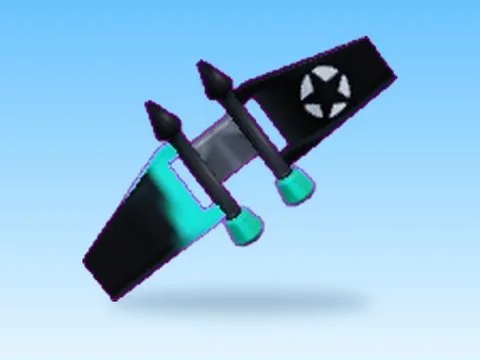 | [Jetpack · +1 Jump Every Second](Jetpack%20%C2%B7%20+1%20Jump%20Every%20Second.md) | Modèle en MeshParts · 1 MeshPart |
| 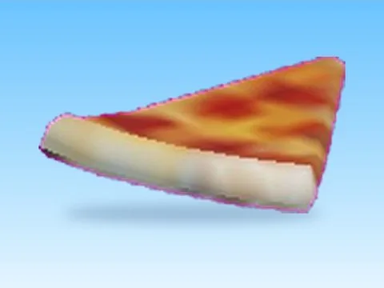 | [Pizza · +1 Health Every Second](Pizza%20%C2%B7%20+1%20Health%20Every%20Second.md) | Modèle en MeshParts · 1 MeshPart |
| 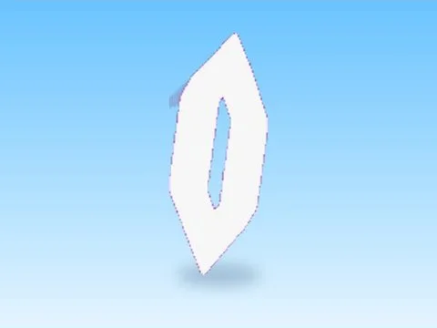 | [R Async Ether Tank · Tweeting Simulator](R%20Async%20Ether%20Tank%20%C2%B7%20Tweeting%20Simulator.md) | Modèle en MeshParts · 1 Part · 3 MeshParts |
| 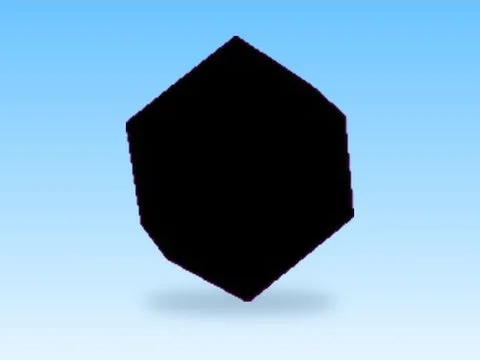 | [R Floans Void Crystal · Tweeting Simulator](R%20Floans%20Void%20Crystal%20%C2%B7%20Tweeting%20Simulator.md) | Modèle en MeshParts · 1 Part · 2 MeshParts |
| 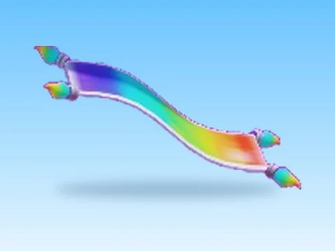 | [Rainbow Magic Carpet · +1 Jump Every Second](Rainbow%20Magic%20Carpet%20%C2%B7%20+1%20Jump%20Every%20Second.md) | Modèle en MeshParts · 1 MeshPart |
| 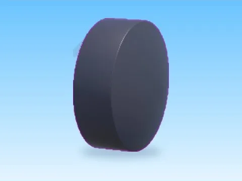 | [Round · Tweeting Simulator](Round%20%C2%B7%20Tweeting%20Simulator.md) | Modèle en MeshParts · 1 Part · 3 MeshParts |
| 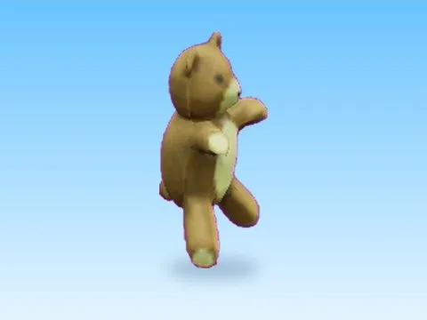 | [Teddy Bear · +1 Health Every Second](Teddy%20Bear%20%C2%B7%20+1%20Health%20Every%20Second.md) | Modèle en MeshParts · 1 MeshPart |
