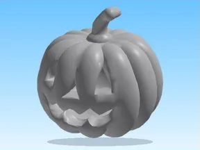

# Halloween Models IA

Modèle en MeshParts « Halloween Models IA ». Aperçu : forme du mesh principal (sans texture).

- **Catégorie** : [Pets & meshes](../Pets%20%26%20meshes.md)
- **Sous-catégorie** : [Halloween](Halloween%20%28Pets%20%26%20meshes%29.md)
- **Type** : Modèle en MeshParts
- **Contenu** : 7 MeshParts
- **Fichier source** : `packs/Halloween/_Archive/HalloweenModels_IA.rbxm` (dans ta bibliothèque `rblx\lib`)
