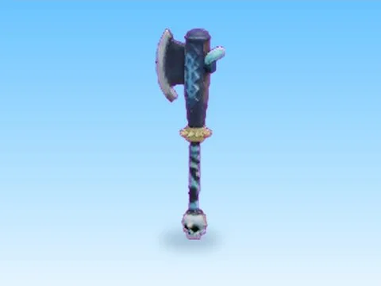

# Haunted Axe

Modèle en MeshParts « Haunted Axe ». Aperçu rendu dans Roblox Studio avec ses vraies textures.

- **Catégorie** : [Pets & meshes](../Pets%20&%20meshes.md)
- **Sous-catégorie** : [Halloween](Halloween%20%28Pets%20&%20meshes%29.md)
- **Type** : Modèle en MeshParts
- **Contenu** : 1 MeshPart
- **Fichier source** : `packs/Halloween/BatSkins_Tools/Haunted Axe.rbxm` (dans ta bibliothèque `rblx\lib`)
