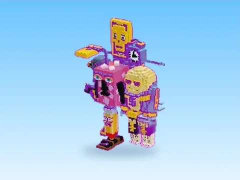

# La Halloween Combinasion

Modèle en MeshParts « La Halloween Combinasion ». Aperçu rendu dans Roblox Studio avec ses vraies textures.

- **Catégorie** : [Pets & meshes](../Pets%20&%20meshes.md)
- **Sous-catégorie** : [Halloween](Halloween%20%28Pets%20&%20meshes%29.md)
- **Type** : Modèle en MeshParts
- **Contenu** : 48 MeshParts
- **Fichier source** : `packs/Halloween/La_Halloween_Combinasion.rbxm` (dans ta bibliothèque `rblx\lib`)
