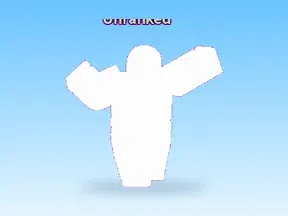

# 1Clicks · Tapping Lords

Modèle en MeshParts « 1Clicks » (Tapping Lords). Aperçu rendu dans Roblox Studio avec ses vraies textures.

- **Catégorie** : [Pets & meshes](../Pets%20%26%20meshes.md)
- **Sous-catégorie** : [Leaderboards & panneaux](Leaderboards%20%26%20panneaux%20%28Pets%20%26%20meshes%29.md)
- **Type** : Modèle en MeshParts
- **Contenu** : 15 MeshParts
- **Jeu d'origine** : Tapping Lords
- **Fichier source** : `models/ByType/Leaderboards_Boards/TappingLords_1Clicks.rbxm` (dans ta bibliothèque `rblx\lib`)
