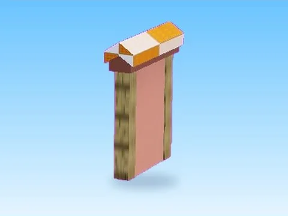
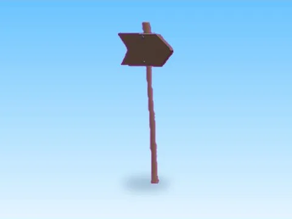
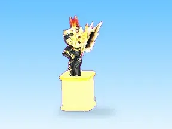
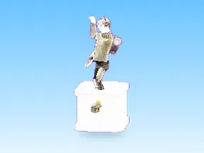

# Leaderboards & panneaux

Sous-catégorie de [Pets & meshes](../Pets%20%26%20meshes.md) · **16 éléments**

| Aperçu | Élément | Infos |
| --- | --- | --- |
|  | [1Clicks · Tapping Lords](1Clicks%20%C2%B7%20Tapping%20Lords.md) | Modèle en MeshParts · 15 MeshParts |
|  | [Champ · Robot Simulator](Champ%20%C2%B7%20Robot%20Simulator.md) | Modèle en MeshParts · 1 Part · 18 MeshParts |
|  | [Design · Cashgrab Bridge](Design%20%C2%B7%20Cashgrab%20Bridge.md) | Modèle en MeshParts · 6 MeshParts |
|  | [Gems · Punch Simulator](Gems%20%C2%B7%20Punch%20Simulator.md) | Modèle en MeshParts · 4 MeshParts |
|  | [Nr1Player · Glass Bridge](Nr1Player%20%C2%B7%20Glass%20Bridge.md) | Modèle en MeshParts · 15 MeshParts |
|  | [Phone Sign · Tweeting Simulator](Phone%20Sign%20%C2%B7%20Tweeting%20Simulator.md) | Modèle en MeshParts · 3 MeshParts |
|  | [Premium Benefit Board · +1 Jump Every Second](Premium%20Benefit%20Board%20%C2%B7%20%2B1%20Jump%20Every%20Second.md) | Modèle en MeshParts · 19 MeshParts |
|  | [Rebirth · Mining Masters](Rebirth%20%C2%B7%20Mining%20Masters%20%C2%B7%20Leaderboards%20%26%20panneaux.md) | Modèle en MeshParts · 11 MeshParts |
|  | [Robux Spent · Training Simulator](Robux%20Spent%20%C2%B7%20Training%20Simulator.md) | Modèle en MeshParts · 5 MeshParts |
|  | [Robux Spent 2 · Training Simulator](Robux%20Spent%202%20%C2%B7%20Training%20Simulator.md) | Modèle en MeshParts · 13 MeshParts |
|  | [Sign · Pet Pharmica](Sign%20%C2%B7%20Pet%20Pharmica.md) | Modèle en MeshParts · 1 MeshPart |
|  | [Sign1 · Rebirth Champions X](Sign1%20%C2%B7%20Rebirth%20Champions%20X.md) | Modèle en MeshParts · 3 MeshParts |
|  | [Top Clicks · Hatching Simulator](Top%20Clicks%20%C2%B7%20Hatching%20Simulator.md) | Modèle en MeshParts · 1 Part · 20 MeshParts |
|  | [Top Rebirths 1 · Rebirth Champions X](Top%20Rebirths%201%20%C2%B7%20Rebirth%20Champions%20X.md) | Modèle en MeshParts · 29 MeshParts |
|  | [Top Rebirths 2 · Rebirth Champions X](Top%20Rebirths%202%20%C2%B7%20Rebirth%20Champions%20X.md) | Modèle en MeshParts · 25 MeshParts |
|  | [Top Rebirths 3 · Rebirth Champions X](Top%20Rebirths%203%20%C2%B7%20Rebirth%20Champions%20X.md) | Modèle en MeshParts · 1 Part · 26 MeshParts |
