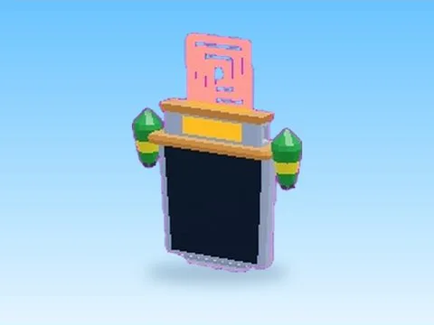

# Premium Benefit Board · +1 Jump Every Second

Modèle en MeshParts « Premium Benefit Board » (+1 Jump Every Second). Aperçu rendu dans Roblox Studio avec ses vraies textures.

- **Catégorie** : [Pets & meshes](../Pets%20&%20meshes.md)
- **Sous-catégorie** : [Leaderboards & panneaux](Leaderboards%20&%20panneaux%20%28Pets%20&%20meshes%29.md)
- **Type** : Modèle en MeshParts
- **Contenu** : 19 MeshParts
- **Jeu d'origine** : +1 Jump Every Second
- **Fichier source** : `Assets/models/ByType/Leaderboards_Boards/1JumpEverySecond_PremiumBenefitBoard.rbxm` (dans le vault)
