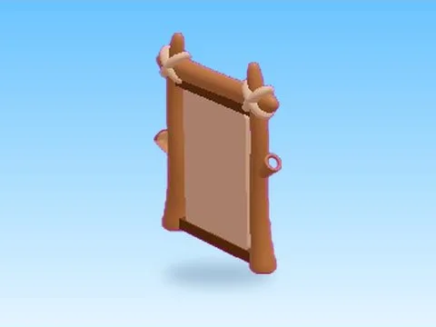

# Rebirth · Mining Masters

Modèle en MeshParts « Rebirth » (Mining Masters). Aperçu rendu dans Roblox Studio avec ses vraies textures.

- **Catégorie** : [Pets & meshes](../Pets%20&%20meshes.md)
- **Sous-catégorie** : [Leaderboards & panneaux](Leaderboards%20&%20panneaux%20%28Pets%20&%20meshes%29.md)
- **Type** : Modèle en MeshParts
- **Contenu** : 11 MeshParts
- **Jeu d'origine** : Mining Masters
- **Fichier source** : `models/ByType/Leaderboards_Boards/MiningMasters_Rebirth.rbxm` (dans ta bibliothèque `rblx\lib`)
