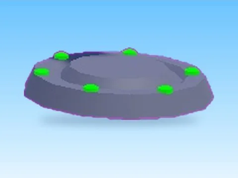

# Robux Spent 2 · Training Simulator

Modèle en MeshParts « Robux Spent 2 » (Training Simulator). Aperçu rendu dans Roblox Studio avec ses vraies textures.

- **Catégorie** : [Pets & meshes](../Pets%20%26%20meshes.md)
- **Sous-catégorie** : [Leaderboards & panneaux](Leaderboards%20%26%20panneaux%20%28Pets%20%26%20meshes%29.md)
- **Type** : Modèle en MeshParts
- **Contenu** : 13 MeshParts
- **Jeu d'origine** : Training Simulator
- **Fichier source** : `models/ByType/Leaderboards_Boards/TrainingSim_RobuxSpent_2.rbxm` (dans ta bibliothèque `rblx\lib`)
