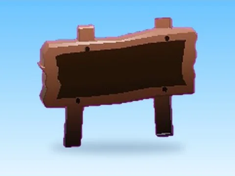

# Sign · Pet Pharmica

Modèle en MeshParts « Sign » (Pet Pharmica). Aperçu rendu dans Roblox Studio avec ses vraies textures.

- **Catégorie** : [Pets & meshes](../Pets%20&%20meshes.md)
- **Sous-catégorie** : [Leaderboards & panneaux](Leaderboards%20&%20panneaux%20%28Pets%20&%20meshes%29.md)
- **Type** : Modèle en MeshParts
- **Contenu** : 1 MeshPart
- **Jeu d'origine** : Pet Pharmica
- **Fichier source** : `Assets/models/ByType/Leaderboards_Boards/PetPharmica_Sign.rbxm` (dans le vault)
