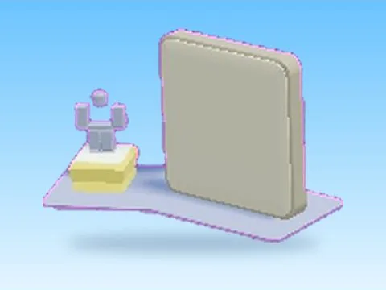

# Top Clicks · Hatching Simulator

Modèle en MeshParts « Top Clicks » (Hatching Simulator). Aperçu rendu dans Roblox Studio avec ses vraies textures.

- **Catégorie** : [Pets & meshes](../Pets%20&%20meshes.md)
- **Sous-catégorie** : [Leaderboards & panneaux](Leaderboards%20&%20panneaux%20%28Pets%20&%20meshes%29.md)
- **Type** : Modèle en MeshParts
- **Contenu** : 1 Part · 20 MeshParts
- **Jeu d'origine** : Hatching Simulator
- **Fichier source** : `Assets/models/ByType/Leaderboards_Boards/HatchingSim_TopClicks.rbxm` (dans le vault)
