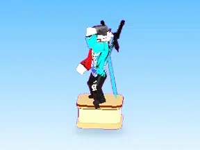

# Top Rebirths 3 · Rebirth Champions X

Modèle en MeshParts « Top Rebirths 3 » (Rebirth Champions X). Aperçu rendu dans Roblox Studio avec ses vraies textures.

- **Catégorie** : [Pets & meshes](../Pets%20&%20meshes.md)
- **Sous-catégorie** : [Leaderboards & panneaux](Leaderboards%20&%20panneaux%20%28Pets%20&%20meshes%29.md)
- **Type** : Modèle en MeshParts
- **Contenu** : 1 Part · 26 MeshParts
- **Jeu d'origine** : Rebirth Champions X
- **Fichier source** : `Assets/models/ByType/Leaderboards_Boards/RebirthChampionsX_TopRebirths_3.rbxm` (dans le vault)
