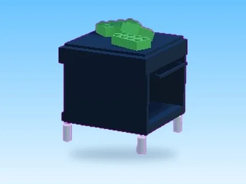

# Lego · Bakery Simulator

Modèle en MeshParts « Lego » (Bakery Simulator). Aperçu rendu dans Roblox Studio avec ses vraies textures.

- **Catégorie** : [Pets & meshes](../Pets%20&%20meshes.md)
- **Sous-catégorie** : [Machines](Machines%20%28Pets%20&%20meshes%29.md)
- **Type** : Modèle en MeshParts
- **Contenu** : 14 Parts · 6 MeshParts
- **Jeu d'origine** : Bakery Simulator
- **Fichier source** : `Assets/models/ByType/Machines_Upgraders/BakerySim_Lego.rbxm` (dans le vault)
