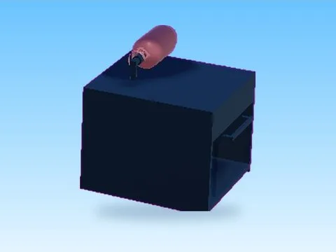
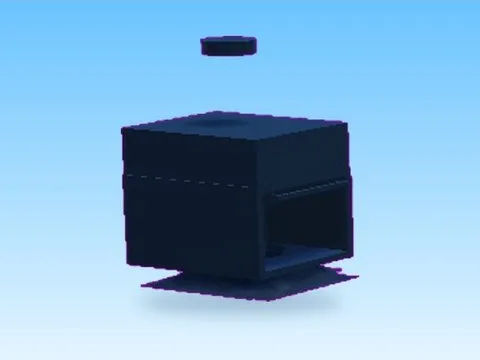
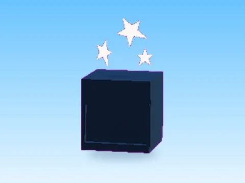
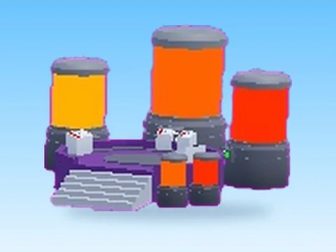
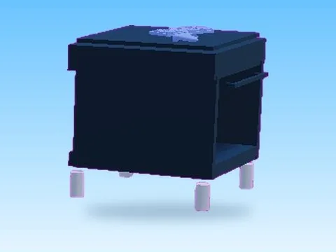
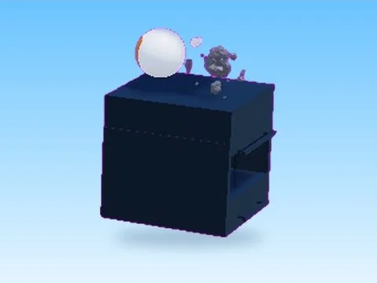
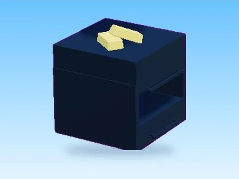
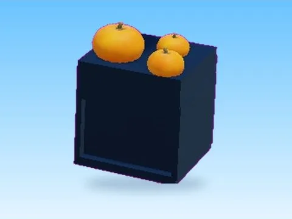

# Machines

Sous-catégorie de [Pets & meshes](../Pets%20%26%20meshes.md) · **20 éléments**

| Aperçu | Élément | Infos |
| --- | --- | --- |
|  | [Alien · Bakery Simulator](Alien%20%C2%B7%20Bakery%20Simulator.md) | Modèle en MeshParts · 12 Parts · 12 MeshParts |
|  | [Banana · Bakery Simulator](Banana%20%C2%B7%20Bakery%20Simulator.md) | Modèle en MeshParts · 13 Parts · 6 MeshParts |
|  | [Basic Propane · Bakery Simulator](Basic%20Propane%20%C2%B7%20Bakery%20Simulator.md) | Modèle en MeshParts · 14 Parts · 4 MeshParts |
|  | [Brick · Bakery Simulator](Brick%20%C2%B7%20Bakery%20Simulator.md) | Modèle en MeshParts · 11 Parts · 6 MeshParts |
|  | [Cauldron Event · Bakery Simulator](Cauldron%20Event%20%C2%B7%20Bakery%20Simulator.md) | Modèle en MeshParts · 51 Parts · 21 MeshParts |
|  | [Celestial · Bakery Simulator](Celestial%20%C2%B7%20Bakery%20Simulator.md) | Modèle en MeshParts · 10 Parts · 6 MeshParts |
|  | [Crafting · Punch Simulator](Crafting%20%C2%B7%20Punch%20Simulator.md) | Modèle en MeshParts · 10 MeshParts |
|  | [Gaming · Bakery Simulator](Gaming%20%C2%B7%20Bakery%20Simulator.md) | Modèle en MeshParts · 14 Parts · 5 MeshParts |
|  | [Heart · Bakery Simulator](Heart%20%C2%B7%20Bakery%20Simulator.md) | Modèle en MeshParts · 13 Parts · 6 MeshParts |
|  | [Honey · Bakery Simulator](Honey%20%C2%B7%20Bakery%20Simulator.md) | Modèle en MeshParts · 14 Parts · 5 MeshParts |
|  | [Lego · Bakery Simulator](Lego%20%C2%B7%20Bakery%20Simulator.md) | Modèle en MeshParts · 14 Parts · 6 MeshParts |
|  | [Mars · Bakery Simulator](Mars%20%C2%B7%20Bakery%20Simulator.md) | Modèle en MeshParts · 13 Parts · 7 MeshParts |
|  | [Melon · Bakery Simulator](Melon%20%C2%B7%20Bakery%20Simulator.md) | Modèle en MeshParts · 14 Parts · 6 MeshParts |
|  | [Ovens Gold · Bakery Simulator](Ovens%20Gold%20%C2%B7%20Bakery%20Simulator.md) | Modèle en MeshParts · 13 Parts · 6 MeshParts |
|  | [Overgrown · Bakery Simulator](Overgrown%20%C2%B7%20Bakery%20Simulator.md) | Modèle en MeshParts · 14 Parts · 7 MeshParts |
|  | [Pet Machine · Rebirth Champions X](Pet%20Machine%20%C2%B7%20Rebirth%20Champions%20X.md) | Modèle en MeshParts · 1 Part · 26 MeshParts |
|  | [Pumpkin · Bakery Simulator](Pumpkin%20%C2%B7%20Bakery%20Simulator.md) | Modèle en MeshParts · 10 Parts · 8 MeshParts |
|  | [Shelves Model 4 · Bakery Simulator](Shelves%20Model%204%20%C2%B7%20Bakery%20Simulator.md) | Modèle en MeshParts · 10 Parts · 4 MeshParts |
|  | [Shelves Model 5 · Bakery Simulator](Shelves%20Model%205%20%C2%B7%20Bakery%20Simulator.md) | Modèle en MeshParts · 2 Parts · 3 MeshParts |
|  | [Upgrade Machine · Lib perso](Upgrade%20Machine%20%C2%B7%20Lib%20perso.md) | Modèle en MeshParts · 5 Parts · 24 MeshParts |
