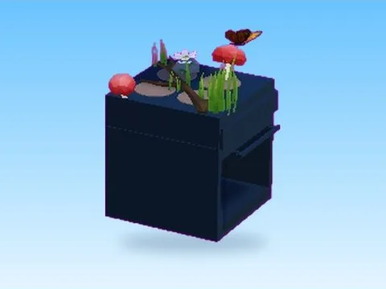

# Overgrown · Bakery Simulator

Modèle en MeshParts « Overgrown » (Bakery Simulator). Aperçu rendu dans Roblox Studio avec ses vraies textures.

- **Catégorie** : [Pets & meshes](../Pets%20&%20meshes.md)
- **Sous-catégorie** : [Machines](Machines%20%28Pets%20&%20meshes%29.md)
- **Type** : Modèle en MeshParts
- **Contenu** : 14 Parts · 7 MeshParts
- **Jeu d'origine** : Bakery Simulator
- **Fichier source** : `models/ByType/Machines_Upgraders/BakerySim_Overgrown.rbxm` (dans ta bibliothèque `rblx\lib`)
