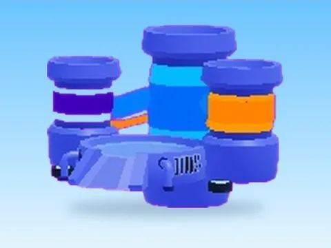

# Upgrade Machine · Lib perso

Modèle en MeshParts « Upgrade Machine » (Lib perso). Aperçu rendu dans Roblox Studio avec ses vraies textures.

- **Catégorie** : [Pets & meshes](../Pets%20&%20meshes.md)
- **Sous-catégorie** : [Machines](Machines%20%28Pets%20&%20meshes%29.md)
- **Type** : Modèle en MeshParts
- **Contenu** : 5 Parts · 24 MeshParts
- **Jeu d'origine** : Lib perso
- **Fichier source** : `models/ByType/Machines_Upgraders/Lib_UpgradeMachine.rbxm` (dans ta bibliothèque `rblx\lib`)
