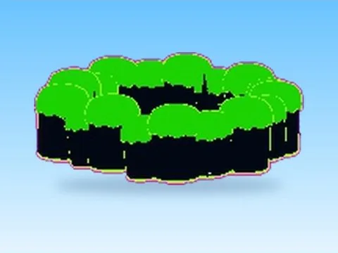

# 11Nuclear · Rebirth Champions X

Modèle en MeshParts « 11Nuclear » (Rebirth Champions X). Aperçu rendu dans Roblox Studio avec ses vraies textures.

- **Catégorie** : [Pets & meshes](../Pets%20%26%20meshes.md)
- **Sous-catégorie** : [Maps & îles](Maps%20%26%20%C3%AEles%20%28Pets%20%26%20meshes%29.md)
- **Type** : Modèle en MeshParts
- **Contenu** : 13 Parts · 95 MeshParts
- **Jeu d'origine** : Rebirth Champions X
- **Fichier source** : `models/ByType/Maps_Islands_Worlds/RebirthChampionsX_11Nuclear.rbxm` (dans ta bibliothèque `rblx\lib`)
