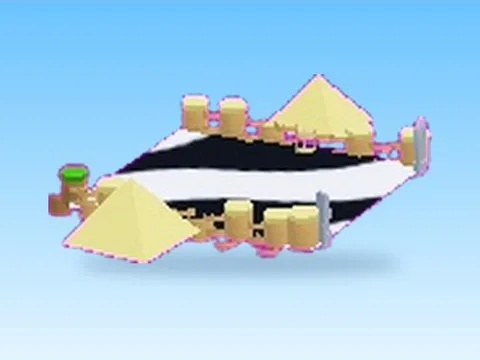

# 2Desert · Pet Pharmica

Modèle en MeshParts « 2Desert » (Pet Pharmica). Aperçu rendu dans Roblox Studio avec ses vraies textures.

- **Catégorie** : [Pets & meshes](../Pets%20&%20meshes.md)
- **Sous-catégorie** : [Maps & îles](Maps%20&%20%C3%AEles%20%28Pets%20&%20meshes%29.md)
- **Type** : Modèle en MeshParts
- **Contenu** : 19 Parts · 184 MeshParts
- **Jeu d'origine** : Pet Pharmica
- **Fichier source** : `models/ByType/Maps_Islands_Worlds/PetPharmica_2Desert.rbxm` (dans ta bibliothèque `rblx\lib`)
