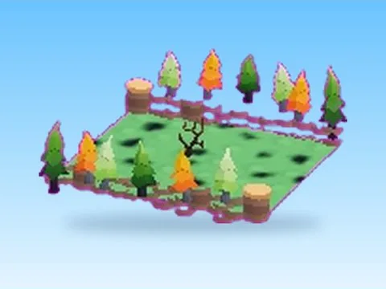

# 3Fall · Pet Pharmica

Modèle en MeshParts « 3Fall » (Pet Pharmica). Aperçu rendu dans Roblox Studio avec ses vraies textures.

- **Catégorie** : [Pets & meshes](../Pets%20%26%20meshes.md)
- **Sous-catégorie** : [Maps & îles](Maps%20%26%20%C3%AEles%20%28Pets%20%26%20meshes%29.md)
- **Type** : Modèle en MeshParts
- **Contenu** : 20 Parts · 168 MeshParts
- **Jeu d'origine** : Pet Pharmica
- **Fichier source** : `models/ByType/Maps_Islands_Worlds/PetPharmica_3Fall.rbxm` (dans ta bibliothèque `rblx\lib`)
