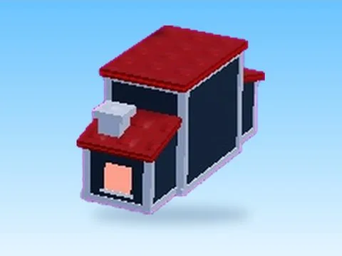

# Island3 · Robot Simulator

Modèle en MeshParts « Island3 » (Robot Simulator). Aperçu rendu dans Roblox Studio avec ses vraies textures.

- **Catégorie** : [Pets & meshes](../Pets%20&%20meshes.md)
- **Sous-catégorie** : [Maps & îles](Maps%20&%20%C3%AEles%20%28Pets%20&%20meshes%29.md)
- **Type** : Modèle en MeshParts
- **Contenu** : 106 Parts · 11 MeshParts
- **Jeu d'origine** : Robot Simulator
- **Fichier source** : `models/ByType/Maps_Islands_Worlds/RobotSim_Island3.rbxm` (dans ta bibliothèque `rblx\lib`)
