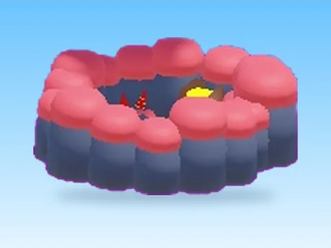

# Lava World · Tapping Lords

Modèle en MeshParts « Lava World » (Tapping Lords). Aperçu rendu dans Roblox Studio avec ses vraies textures.

- **Catégorie** : [Pets & meshes](../Pets%20%26%20meshes.md)
- **Sous-catégorie** : [Maps & îles](Maps%20%26%20%C3%AEles%20%28Pets%20%26%20meshes%29.md)
- **Type** : Modèle en MeshParts
- **Contenu** : 32 Parts · 111 MeshParts
- **Jeu d'origine** : Tapping Lords
- **Fichier source** : `models/ByType/Maps_Islands_Worlds/TappingLords_LavaWorld.rbxm` (dans ta bibliothèque `rblx\lib`)
