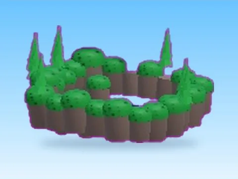
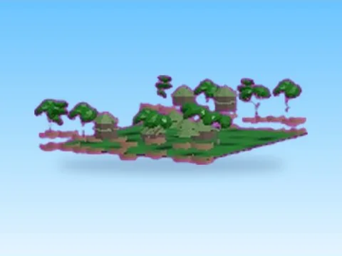
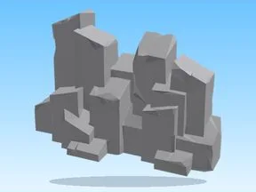
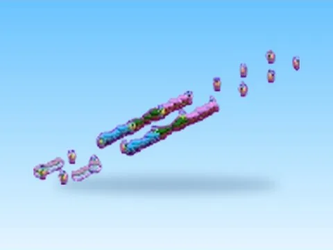
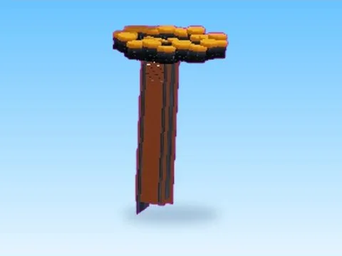
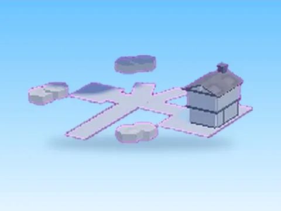
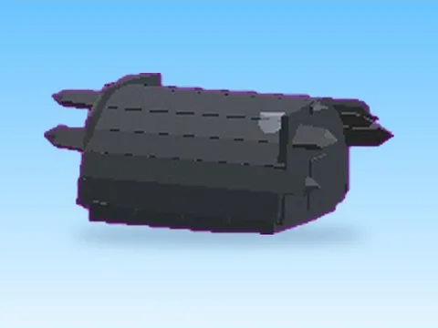

# Maps & îles

Sous-catégorie de [Pets & meshes](../Pets%20&%20meshes.md) · **19 éléments**

| Aperçu | Élément | Infos |
| --- | --- | --- |
|  | [10Heaven · Rebirth Champions X](10Heaven%20%C2%B7%20Rebirth%20Champions%20X.md) | Modèle en MeshParts · 1 Part · 107 MeshParts |
|  | [11Nuclear · Rebirth Champions X](11Nuclear%20%C2%B7%20Rebirth%20Champions%20X.md) | Modèle en MeshParts · 13 Parts · 95 MeshParts |
|  | [1Forest · Rebirth Champions X](1Forest%20%C2%B7%20Rebirth%20Champions%20X.md) | Modèle en MeshParts · 8 Parts · 481 MeshParts |
|  | [2Desert · Pet Pharmica](2Desert%20%C2%B7%20Pet%20Pharmica.md) | Modèle en MeshParts · 19 Parts · 184 MeshParts |
|  | [3Fall · Pet Pharmica](3Fall%20%C2%B7%20Pet%20Pharmica.md) | Modèle en MeshParts · 20 Parts · 168 MeshParts |
|  | [4Desert · Rebirth Champions X](4Desert%20%C2%B7%20Rebirth%20Champions%20X.md) | Modèle en MeshParts · 4 Parts · 99 MeshParts |
|  | [4Winter · Pet Pharmica](4Winter%20%C2%B7%20Pet%20Pharmica.md) | Modèle en MeshParts · 43 Parts · 172 MeshParts |
|  | [5Forest · Pet Pharmica](5Forest%20%C2%B7%20Pet%20Pharmica.md) | Modèle en MeshParts · 301 Parts · 251 MeshParts |
|  | [6Atlantis · Pet Pharmica](6Atlantis%20%C2%B7%20Pet%20Pharmica.md) | Modèle en MeshParts · 59 Parts · 208 MeshParts |
|  | [8Cyber Model · Rebirth Champions X](8Cyber%20Model%20%C2%B7%20Rebirth%20Champions%20X.md) | Modèle en MeshParts · 3 Parts · 48 MeshParts |
|  | [Assets · Mining Masters](Assets%20%C2%B7%20Mining%20Masters.md) | Modèle en MeshParts · 6 Parts · 922 MeshParts |
|  | [Cave Zone · Mining Masters](Cave%20Zone%20%C2%B7%20Mining%20Masters.md) | Modèle en MeshParts · 169 MeshParts |
|  | [Gypsy Area · Pet Pharmica](Gypsy%20Area%20%C2%B7%20Pet%20Pharmica.md) | Modèle en MeshParts · 25 Parts · 46 MeshParts |
|  | [Halloween Event · Mining Masters](Halloween%20Event%20%C2%B7%20Mining%20Masters.md) | Modèle en MeshParts · 19 Parts · 440 MeshParts |
|  | [Island1 · Robot Simulator](Island1%20%C2%B7%20Robot%20Simulator.md) | Modèle en MeshParts · 273 Parts · 16 MeshParts |
|  | [Island3 · Robot Simulator](Island3%20%C2%B7%20Robot%20Simulator.md) | Modèle en MeshParts · 106 Parts · 11 MeshParts |
|  | [Lava World · Tapping Lords](Lava%20World%20%C2%B7%20Tapping%20Lords.md) | Modèle en MeshParts · 32 Parts · 111 MeshParts |
|  | [Map · Bakery Simulator](Map%20%C2%B7%20Bakery%20Simulator.md) | Modèle en MeshParts · 705 Parts · 663 MeshParts |
|  | [Overworld Secret · Pet Pharmica](Overworld%20Secret%20%C2%B7%20Pet%20Pharmica.md) | Modèle en MeshParts · 17 Parts · 104 MeshParts |
