# Nature · Arbres

Sous-catégorie de [Pets & meshes](../Pets%20%26%20meshes.md) · **72 éléments**

| Aperçu | Élément | Infos |
| --- | --- | --- |
|  | [Tree Acacia 1](Tree%20Acacia%201.md) | Modèle en MeshParts · 1 MeshPart |
| 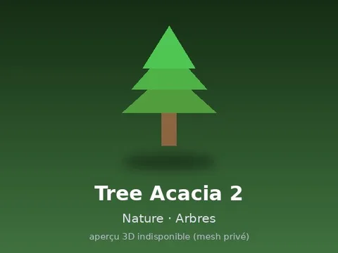 | [Tree Acacia 2](Tree%20Acacia%202.md) | Modèle en MeshParts · 1 MeshPart |
| 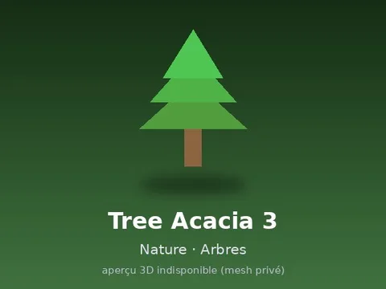 | [Tree Acacia 3](Tree%20Acacia%203.md) | Modèle en MeshParts · 1 MeshPart |
| 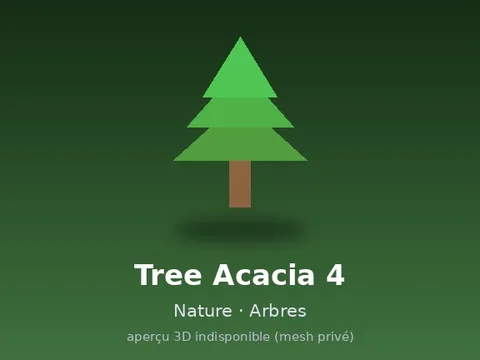 | [Tree Acacia 4](Tree%20Acacia%204.md) | Modèle en MeshParts · 1 MeshPart |
| 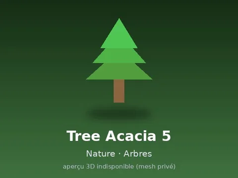 | [Tree Acacia 5](Tree%20Acacia%205.md) | Modèle en MeshParts · 1 MeshPart |
| 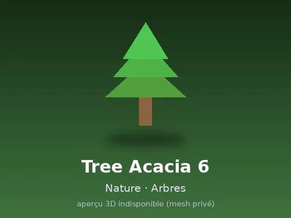 | [Tree Acacia 6](Tree%20Acacia%206.md) | Modèle en MeshParts · 1 MeshPart |
| 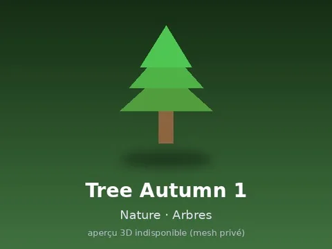 | [Tree Autumn 1](Tree%20Autumn%201.md) | Modèle en MeshParts · 1 MeshPart |
|  | [Tree Autumn 2](Tree%20Autumn%202.md) | Modèle en MeshParts · 1 MeshPart |
|  | [Tree Autumn 3](Tree%20Autumn%203.md) | Modèle en MeshParts · 1 MeshPart |
| 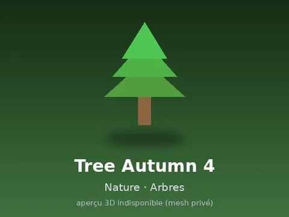 | [Tree Autumn 4](Tree%20Autumn%204.md) | Modèle en MeshParts · 1 MeshPart |
| 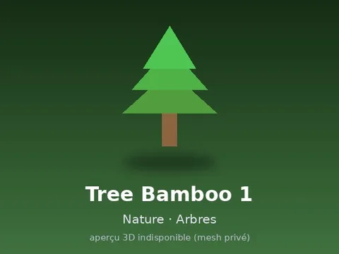 | [Tree Bamboo 1](Tree%20Bamboo%201.md) | Modèle en MeshParts · 1 MeshPart |
| 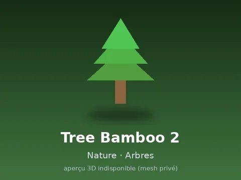 | [Tree Bamboo 2](Tree%20Bamboo%202.md) | Modèle en MeshParts · 1 MeshPart |
| 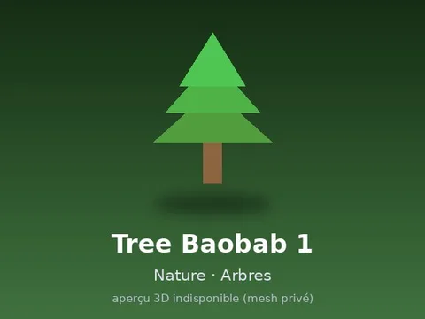 | [Tree Baobab 1](Tree%20Baobab%201.md) | Modèle en MeshParts · 1 MeshPart |
| 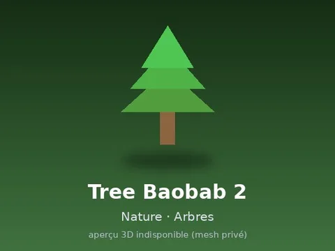 | [Tree Baobab 2](Tree%20Baobab%202.md) | Modèle en MeshParts · 1 MeshPart |
| 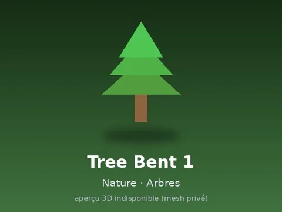 | [Tree Bent 1](Tree%20Bent%201.md) | Modèle en MeshParts · 1 MeshPart |
|  | [Tree Birch 1](Tree%20Birch%201.md) | Modèle en MeshParts · 1 MeshPart |
| 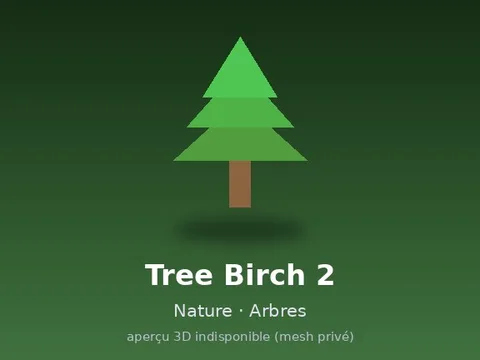 | [Tree Birch 2](Tree%20Birch%202.md) | Modèle en MeshParts · 1 MeshPart |
| 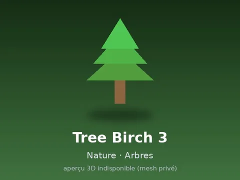 | [Tree Birch 3](Tree%20Birch%203.md) | Modèle en MeshParts · 1 MeshPart |
|  | [Tree Birch 4](Tree%20Birch%204.md) | Modèle en MeshParts · 1 MeshPart |
| 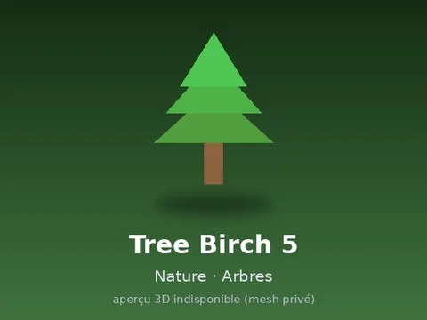 | [Tree Birch 5](Tree%20Birch%205.md) | Modèle en MeshParts · 1 MeshPart |
|  | [Tree Birch 6](Tree%20Birch%206.md) | Modèle en MeshParts · 1 MeshPart |
|  | [Tree Blossom 1](Tree%20Blossom%201.md) | Modèle en MeshParts · 1 MeshPart |
| 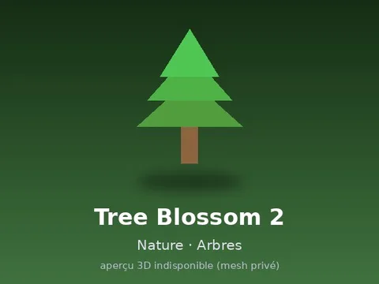 | [Tree Blossom 2](Tree%20Blossom%202.md) | Modèle en MeshParts · 1 MeshPart |
| 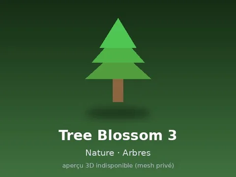 | [Tree Blossom 3](Tree%20Blossom%203.md) | Modèle en MeshParts · 1 MeshPart |
| 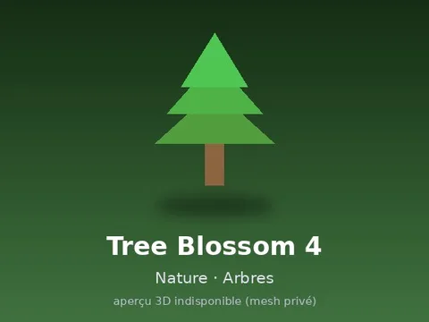 | [Tree Blossom 4](Tree%20Blossom%204.md) | Modèle en MeshParts · 1 MeshPart |
| 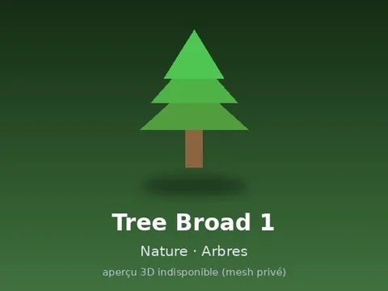 | [Tree Broad 1](Tree%20Broad%201.md) | Modèle en MeshParts · 1 MeshPart |
| 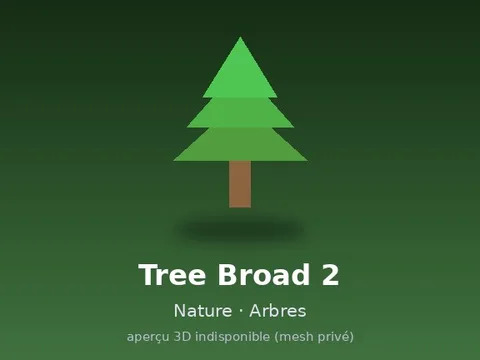 | [Tree Broad 2](Tree%20Broad%202.md) | Modèle en MeshParts · 1 MeshPart |
|  | [Tree Broad 3](Tree%20Broad%203.md) | Modèle en MeshParts · 1 MeshPart |
|  | [Tree Broad 4](Tree%20Broad%204.md) | Modèle en MeshParts · 1 MeshPart |
| 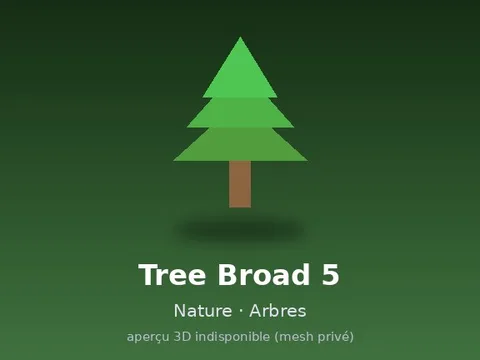 | [Tree Broad 5](Tree%20Broad%205.md) | Modèle en MeshParts · 1 MeshPart |
|  | [Tree Broad 6](Tree%20Broad%206.md) | Modèle en MeshParts · 1 MeshPart |
| 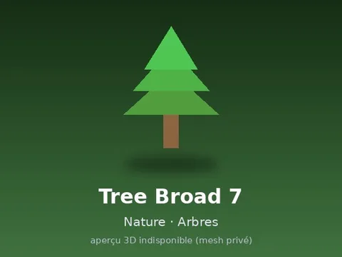 | [Tree Broad 7](Tree%20Broad%207.md) | Modèle en MeshParts · 1 MeshPart |
| 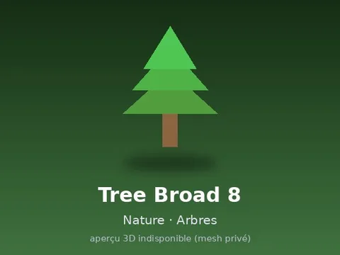 | [Tree Broad 8](Tree%20Broad%208.md) | Modèle en MeshParts · 1 MeshPart |
|  | [Tree Dead 1](Tree%20Dead%201.md) | Modèle en MeshParts · 1 MeshPart |
|  | [Tree Dead 2](Tree%20Dead%202.md) | Modèle en MeshParts · 1 MeshPart |
|  | [Tree Dead 3](Tree%20Dead%203.md) | Modèle en MeshParts · 1 MeshPart |
| 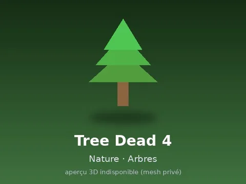 | [Tree Dead 4](Tree%20Dead%204.md) | Modèle en MeshParts · 1 MeshPart |
| 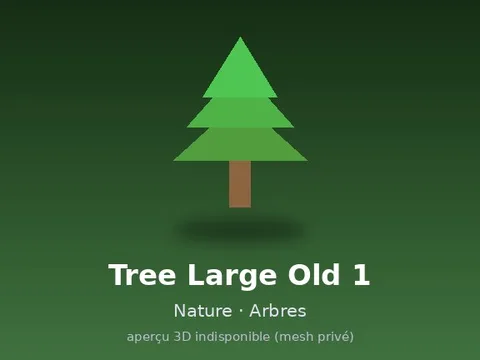 | [Tree Large Old 1](Tree%20Large%20Old%201.md) | Modèle en MeshParts · 1 MeshPart |
| 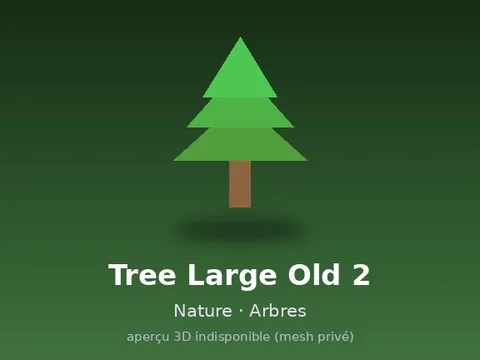 | [Tree Large Old 2](Tree%20Large%20Old%202.md) | Modèle en MeshParts · 1 MeshPart |
| 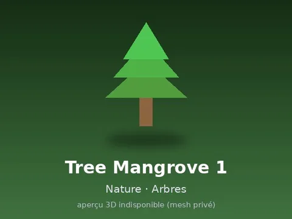 | [Tree Mangrove 1](Tree%20Mangrove%201.md) | Modèle en MeshParts · 1 MeshPart |
| 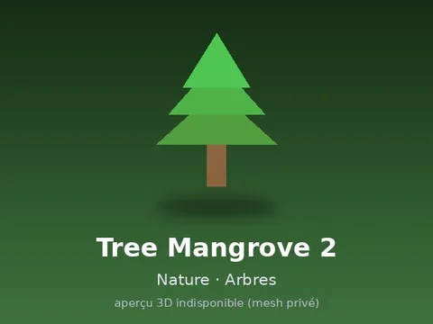 | [Tree Mangrove 2](Tree%20Mangrove%202.md) | Modèle en MeshParts · 1 MeshPart |
|  | [Tree Pine 1](Tree%20Pine%201.md) | Modèle en MeshParts · 1 MeshPart |
| 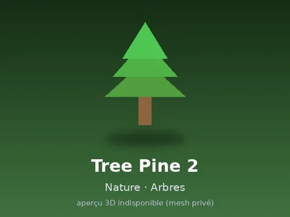 | [Tree Pine 2](Tree%20Pine%202.md) | Modèle en MeshParts · 1 MeshPart |
| 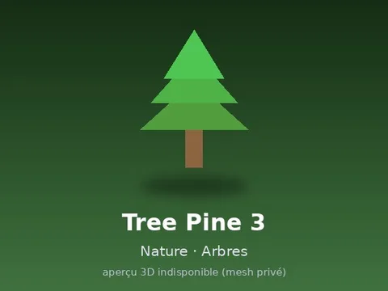 | [Tree Pine 3](Tree%20Pine%203.md) | Modèle en MeshParts · 1 MeshPart |
|  | [Tree Pine 4](Tree%20Pine%204.md) | Modèle en MeshParts · 1 MeshPart |
| 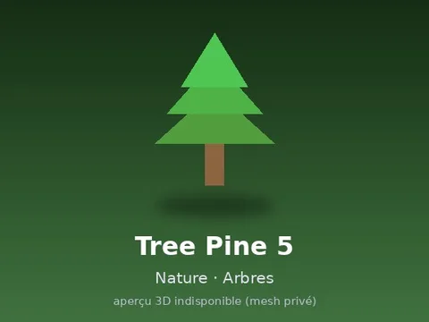 | [Tree Pine 5](Tree%20Pine%205.md) | Modèle en MeshParts · 1 MeshPart |
| 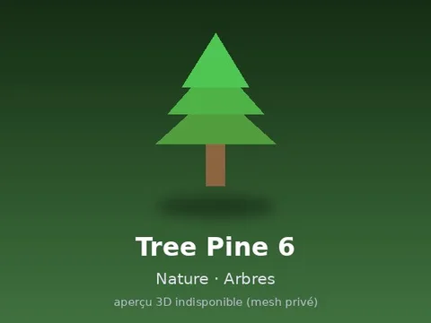 | [Tree Pine 6](Tree%20Pine%206.md) | Modèle en MeshParts · 1 MeshPart |
|  | [Tree Savanna 1](Tree%20Savanna%201.md) | Modèle en MeshParts · 1 MeshPart |
| 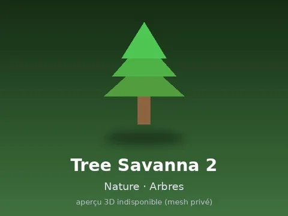 | [Tree Savanna 2](Tree%20Savanna%202.md) | Modèle en MeshParts · 1 MeshPart |
| 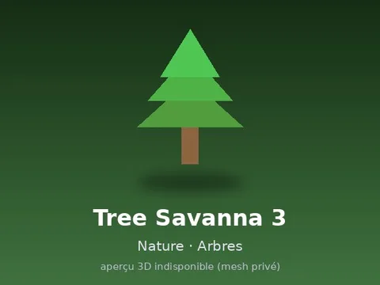 | [Tree Savanna 3](Tree%20Savanna%203.md) | Modèle en MeshParts · 1 MeshPart |
| 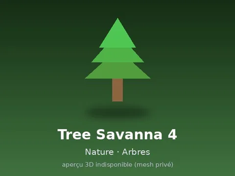 | [Tree Savanna 4](Tree%20Savanna%204.md) | Modèle en MeshParts · 1 MeshPart |
| 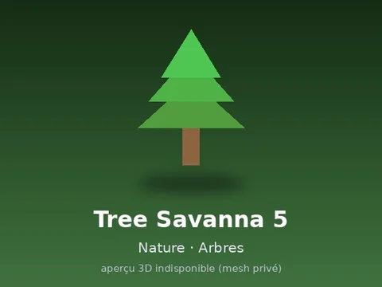 | [Tree Savanna 5](Tree%20Savanna%205.md) | Modèle en MeshParts · 1 MeshPart |
| 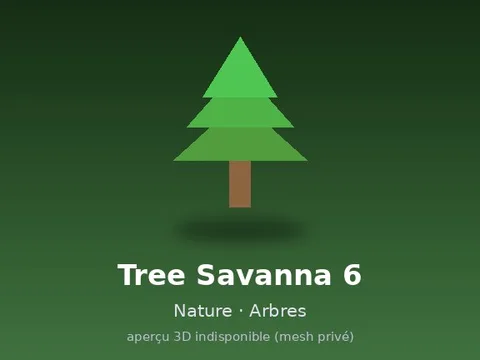 | [Tree Savanna 6](Tree%20Savanna%206.md) | Modèle en MeshParts · 1 MeshPart |
| 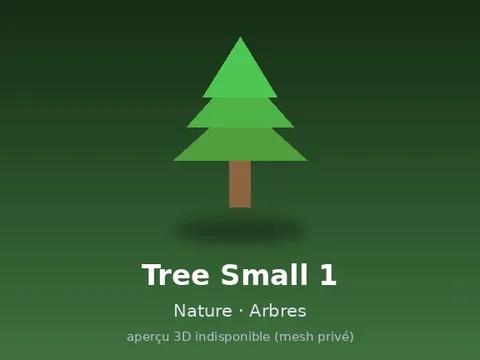 | [Tree Small 1](Tree%20Small%201.md) | Modèle en MeshParts · 1 MeshPart |
| 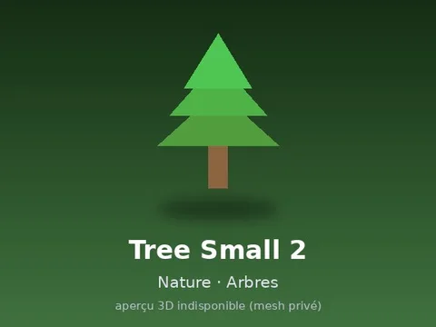 | [Tree Small 2](Tree%20Small%202.md) | Modèle en MeshParts · 1 MeshPart |
| 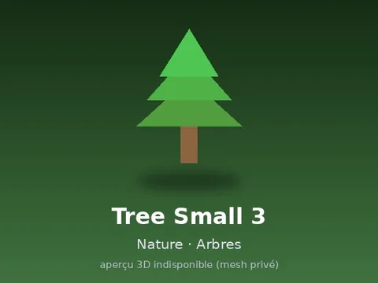 | [Tree Small 3](Tree%20Small%203.md) | Modèle en MeshParts · 1 MeshPart |
| 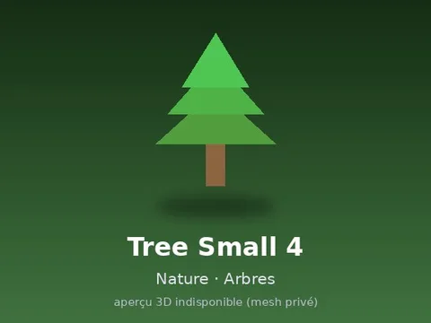 | [Tree Small 4](Tree%20Small%204.md) | Modèle en MeshParts · 1 MeshPart |
| 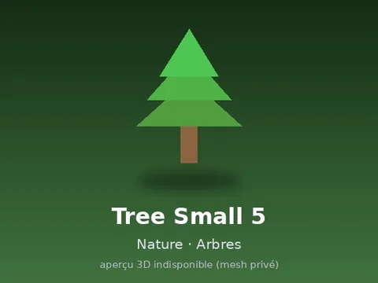 | [Tree Small 5](Tree%20Small%205.md) | Modèle en MeshParts · 1 MeshPart |
| 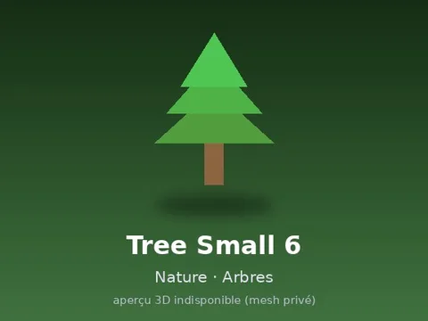 | [Tree Small 6](Tree%20Small%206.md) | Modèle en MeshParts · 1 MeshPart |
| 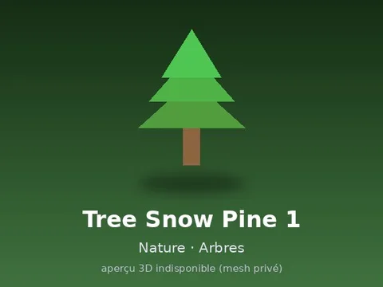 | [Tree Snow Pine 1](Tree%20Snow%20Pine%201.md) | Modèle en MeshParts · 1 MeshPart |
| 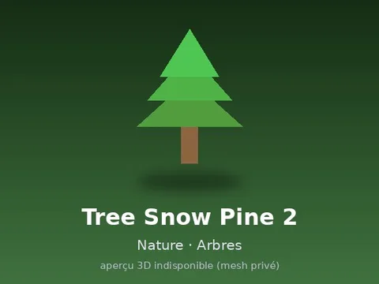 | [Tree Snow Pine 2](Tree%20Snow%20Pine%202.md) | Modèle en MeshParts · 1 MeshPart |
|  | [Tree Snow Pine 3](Tree%20Snow%20Pine%203.md) | Modèle en MeshParts · 1 MeshPart |
| 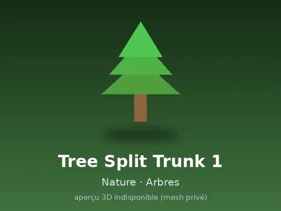 | [Tree Split Trunk 1](Tree%20Split%20Trunk%201.md) | Modèle en MeshParts · 1 MeshPart |
| 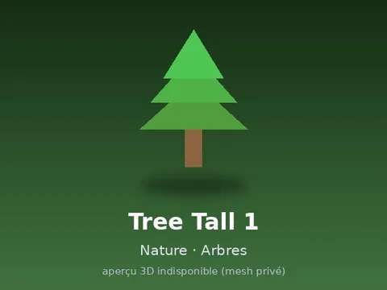 | [Tree Tall 1](Tree%20Tall%201.md) | Modèle en MeshParts · 1 MeshPart |
|  | [Tree Tall 2](Tree%20Tall%202.md) | Modèle en MeshParts · 1 MeshPart |
| 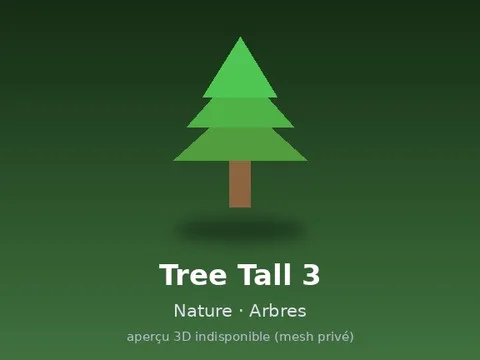 | [Tree Tall 3](Tree%20Tall%203.md) | Modèle en MeshParts · 1 MeshPart |
| 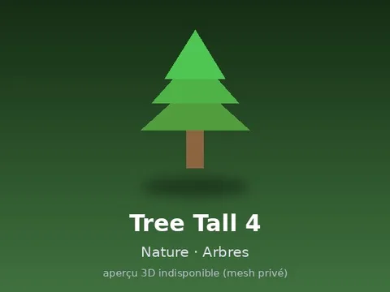 | [Tree Tall 4](Tree%20Tall%204.md) | Modèle en MeshParts · 1 MeshPart |
| 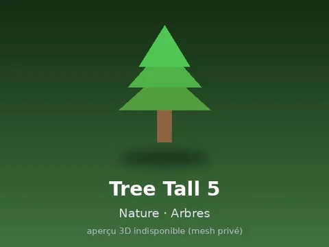 | [Tree Tall 5](Tree%20Tall%205.md) | Modèle en MeshParts · 1 MeshPart |
|  | [Tree Tall 6](Tree%20Tall%206.md) | Modèle en MeshParts · 1 MeshPart |
|  | [Tree Willow 1](Tree%20Willow%201.md) | Modèle en MeshParts · 1 MeshPart |
|  | [Tree Willow 2](Tree%20Willow%202.md) | Modèle en MeshParts · 1 MeshPart |
|  | [Tree Willow 3](Tree%20Willow%203.md) | Modèle en MeshParts · 1 MeshPart |
