# Nature · Bois & racines

Sous-catégorie de [Pets & meshes](../Pets%20&%20meshes.md) · **42 éléments**

| Aperçu | Élément | Infos |
| --- | --- | --- |
|  | [Branch Broken 1](Branch%20Broken%201.md) | Modèle en MeshParts · 1 MeshPart |
|  | [Branch Dead 1](Branch%20Dead%201.md) | Modèle en MeshParts · 1 MeshPart |
| 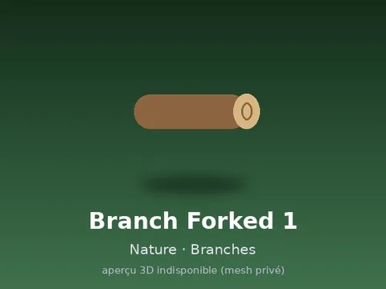 | [Branch Forked 1](Branch%20Forked%201.md) | Modèle en MeshParts · 1 MeshPart |
|  | [Branch Forked 2](Branch%20Forked%202.md) | Modèle en MeshParts · 1 MeshPart |
|  | [Branch Large 1](Branch%20Large%201.md) | Modèle en MeshParts · 1 MeshPart |
| 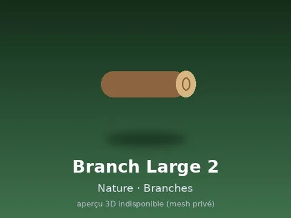 | [Branch Large 2](Branch%20Large%202.md) | Modèle en MeshParts · 1 MeshPart |
| 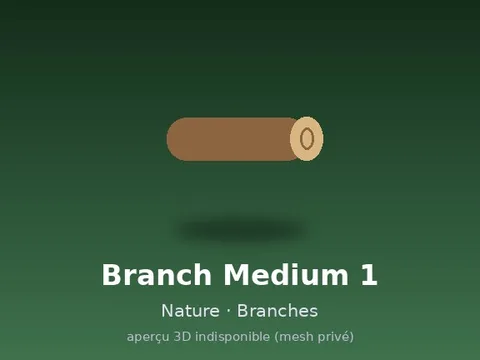 | [Branch Medium 1](Branch%20Medium%201.md) | Modèle en MeshParts · 1 MeshPart |
| 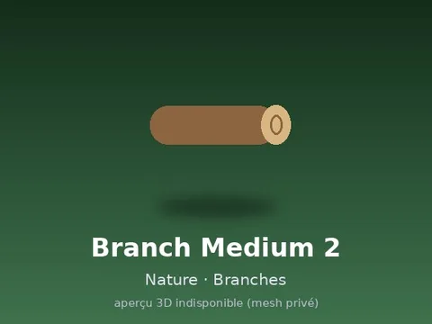 | [Branch Medium 2](Branch%20Medium%202.md) | Modèle en MeshParts · 1 MeshPart |
|  | [Branch Medium 3](Branch%20Medium%203.md) | Modèle en MeshParts · 1 MeshPart |
|  | [Branch Small 1](Branch%20Small%201.md) | Modèle en MeshParts · 1 MeshPart |
|  | [Branch Small 2](Branch%20Small%202.md) | Modèle en MeshParts · 1 MeshPart |
|  | [Branch Small 3](Branch%20Small%203.md) | Modèle en MeshParts · 1 MeshPart |
| 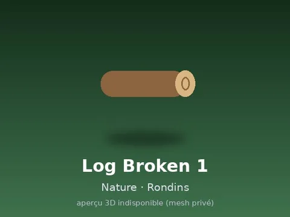 | [Log Broken 1](Log%20Broken%201.md) | Modèle en MeshParts · 1 MeshPart |
|  | [Log Broken 2](Log%20Broken%202.md) | Modèle en MeshParts · 1 MeshPart |
|  | [Log Hollow 1](Log%20Hollow%201.md) | Modèle en MeshParts · 1 MeshPart |
|  | [Log Large 1](Log%20Large%201.md) | Modèle en MeshParts · 1 MeshPart |
|  | [Log Large 2](Log%20Large%202.md) | Modèle en MeshParts · 1 MeshPart |
| 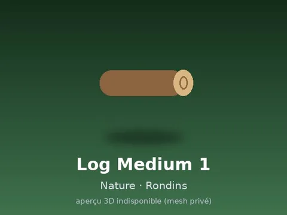 | [Log Medium 1](Log%20Medium%201.md) | Modèle en MeshParts · 1 MeshPart |
|  | [Log Medium 2](Log%20Medium%202.md) | Modèle en MeshParts · 1 MeshPart |
|  | [Log Medium 3](Log%20Medium%203.md) | Modèle en MeshParts · 1 MeshPart |
| 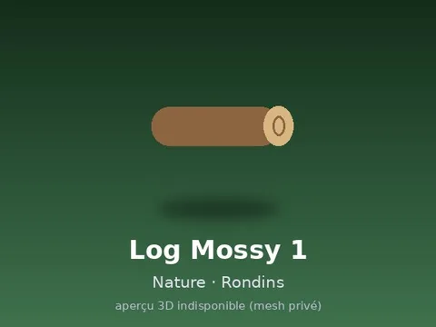 | [Log Mossy 1](Log%20Mossy%201.md) | Modèle en MeshParts · 1 MeshPart |
| 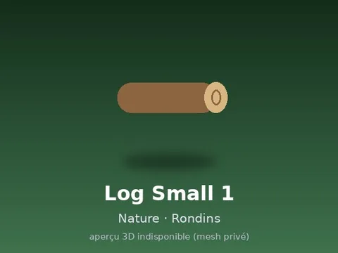 | [Log Small 1](Log%20Small%201.md) | Modèle en MeshParts · 1 MeshPart |
|  | [Log Small 2](Log%20Small%202.md) | Modèle en MeshParts · 1 MeshPart |
|  | [Log Small 3](Log%20Small%203.md) | Modèle en MeshParts · 1 MeshPart |
|  | [Root Cluster 1](Root%20Cluster%201.md) | Modèle en MeshParts · 1 MeshPart |
|  | [Root Cluster 2](Root%20Cluster%202.md) | Modèle en MeshParts · 1 MeshPart |
| 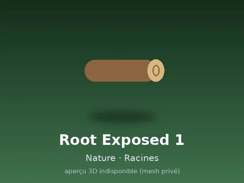 | [Root Exposed 1](Root%20Exposed%201.md) | Modèle en MeshParts · 1 MeshPart |
|  | [Root Exposed 2](Root%20Exposed%202.md) | Modèle en MeshParts · 1 MeshPart |
| 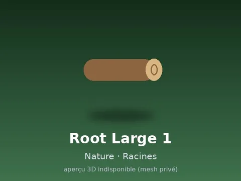 | [Root Large 1](Root%20Large%201.md) | Modèle en MeshParts · 1 MeshPart |
|  | [Root Large 2](Root%20Large%202.md) | Modèle en MeshParts · 1 MeshPart |
|  | [Root Medium 1](Root%20Medium%201.md) | Modèle en MeshParts · 1 MeshPart |
|  | [Root Medium 2](Root%20Medium%202.md) | Modèle en MeshParts · 1 MeshPart |
| 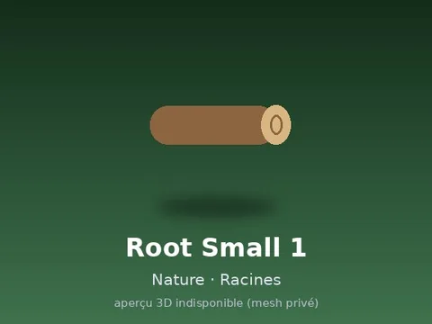 | [Root Small 1](Root%20Small%201.md) | Modèle en MeshParts · 1 MeshPart |
|  | [Root Small 2](Root%20Small%202.md) | Modèle en MeshParts · 1 MeshPart |
| 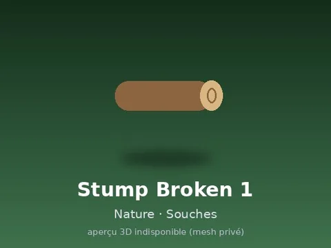 | [Stump Broken 1](Stump%20Broken%201.md) | Modèle en MeshParts · 1 MeshPart |
|  | [Stump Large 1](Stump%20Large%201.md) | Modèle en MeshParts · 1 MeshPart |
|  | [Stump Large 2](Stump%20Large%202.md) | Modèle en MeshParts · 1 MeshPart |
|  | [Stump Medium 1](Stump%20Medium%201.md) | Modèle en MeshParts · 1 MeshPart |
|  | [Stump Medium 2](Stump%20Medium%202.md) | Modèle en MeshParts · 1 MeshPart |
|  | [Stump Rooted 1](Stump%20Rooted%201.md) | Modèle en MeshParts · 1 MeshPart |
|  | [Stump Small 1](Stump%20Small%201.md) | Modèle en MeshParts · 1 MeshPart |
| 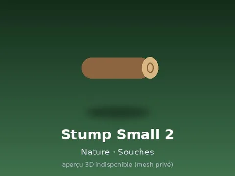 | [Stump Small 2](Stump%20Small%202.md) | Modèle en MeshParts · 1 MeshPart |
