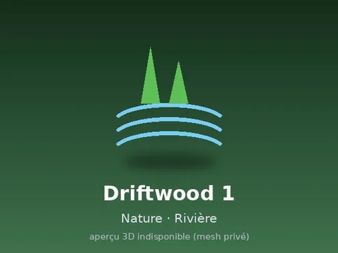

# Driftwood 1

Modèle en MeshParts « Driftwood 1 ». Pas d’aperçu 3D : mesh privé du compte LFT_Labs (le .rbxm marche quand même dans Studio connecté avec ce compte).

- **Catégorie** : [Pets & meshes](../Pets%20&%20meshes.md)
- **Sous-catégorie** : [Nature · Eau & rivages](Nature%20%C2%B7%20Eau%20&%20rivages.md)
- **Type** : Modèle en MeshParts
- **Contenu** : 1 MeshPart
- **Pack d'origine** : Roblox Nature 480 (`600.rbxm`)
- **Fichier source** : `Assets/Nature 480/20 Rivière/DRIFTWOOD_01.rbxm` (dans le dossier Rake Vault, aussi téléchargeable depuis le vault 3D)
- **Meshes** : privés (compte Roblox LFT_Labs), pas d'aperçu 3D disponible
