# Nature · Eau & rivages

Sous-catégorie de [Pets & meshes](../Pets%20&%20meshes.md) · **48 éléments**

| Aperçu | Élément | Infos |
| --- | --- | --- |
|  | [Beach Grass 1](Beach%20Grass%201.md) | Modèle en MeshParts · 1 MeshPart |
|  | [Beach Grass 2](Beach%20Grass%202.md) | Modèle en MeshParts · 1 MeshPart |
| 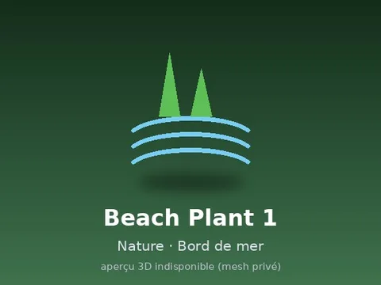 | [Beach Plant 1](Beach%20Plant%201.md) | Modèle en MeshParts · 1 MeshPart |
| 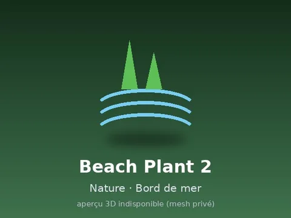 | [Beach Plant 2](Beach%20Plant%202.md) | Modèle en MeshParts · 1 MeshPart |
| 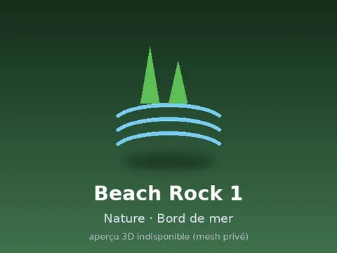 | [Beach Rock 1](Beach%20Rock%201.md) | Modèle en MeshParts · 1 MeshPart |
| 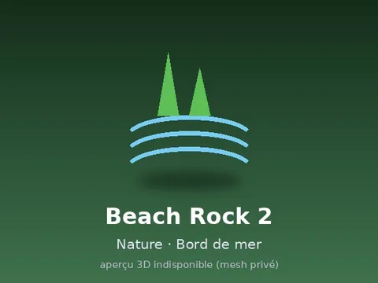 | [Beach Rock 2](Beach%20Rock%202.md) | Modèle en MeshParts · 1 MeshPart |
|  | [Beach Rock 3](Beach%20Rock%203.md) | Modèle en MeshParts · 1 MeshPart |
| 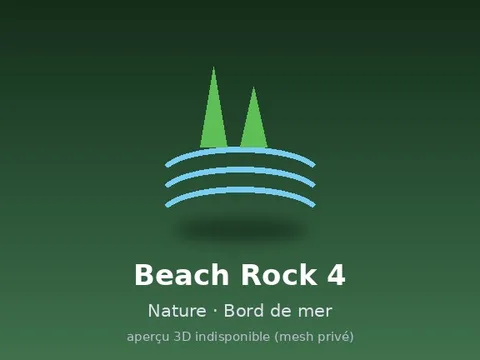 | [Beach Rock 4](Beach%20Rock%204.md) | Modèle en MeshParts · 1 MeshPart |
|  | [Cattail 1](Cattail%201.md) | Modèle en MeshParts · 1 MeshPart |
|  | [Cattail 2](Cattail%202.md) | Modèle en MeshParts · 1 MeshPart |
|  | [Cattail 3](Cattail%203.md) | Modèle en MeshParts · 1 MeshPart |
|  | [Cattail 4](Cattail%204.md) | Modèle en MeshParts · 1 MeshPart |
|  | [Driftwood 1](Driftwood%201.md) | Modèle en MeshParts · 1 MeshPart |
|  | [Driftwood 2](Driftwood%202.md) | Modèle en MeshParts · 1 MeshPart |
| 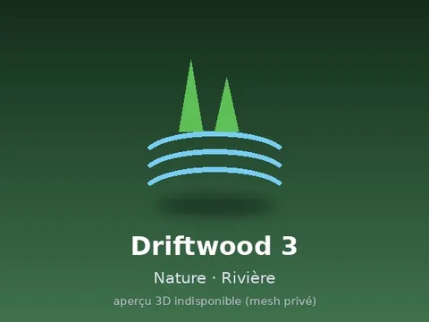 | [Driftwood 3](Driftwood%203.md) | Modèle en MeshParts · 1 MeshPart |
|  | [Driftwood Beach 1](Driftwood%20Beach%201.md) | Modèle en MeshParts · 1 MeshPart |
| 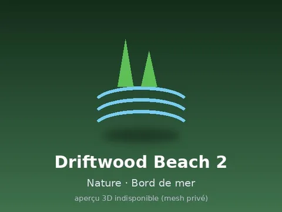 | [Driftwood Beach 2](Driftwood%20Beach%202.md) | Modèle en MeshParts · 1 MeshPart |
| 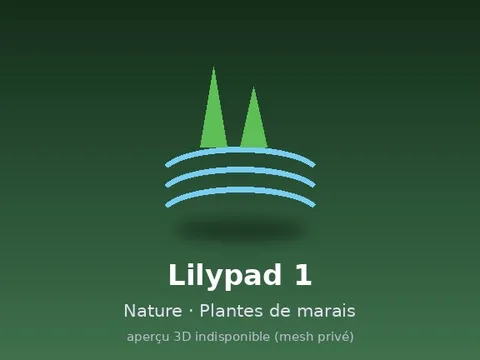 | [Lilypad 1](Lilypad%201.md) | Modèle en MeshParts · 1 MeshPart |
|  | [Lilypad 2](Lilypad%202.md) | Modèle en MeshParts · 1 MeshPart |
|  | [Lilypad 3](Lilypad%203.md) | Modèle en MeshParts · 1 MeshPart |
|  | [Lilypad Cluster 1](Lilypad%20Cluster%201.md) | Modèle en MeshParts · 1 MeshPart |
|  | [Lotus 1](Lotus%201.md) | Modèle en MeshParts · 1 MeshPart |
|  | [Lotus 2](Lotus%202.md) | Modèle en MeshParts · 1 MeshPart |
| 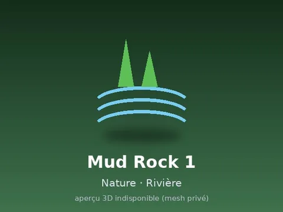 | [Mud Rock 1](Mud%20Rock%201.md) | Modèle en MeshParts · 1 MeshPart |
| 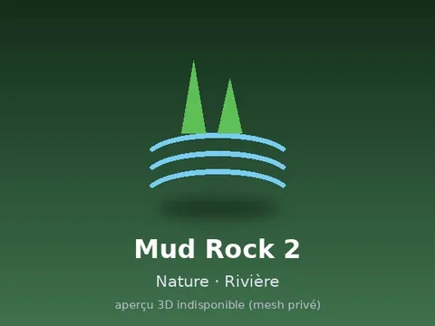 | [Mud Rock 2](Mud%20Rock%202.md) | Modèle en MeshParts · 1 MeshPart |
| 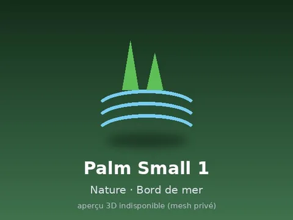 | [Palm Small 1](Palm%20Small%201.md) | Modèle en MeshParts · 1 MeshPart |
| 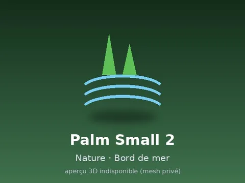 | [Palm Small 2](Palm%20Small%202.md) | Modèle en MeshParts · 1 MeshPart |
| 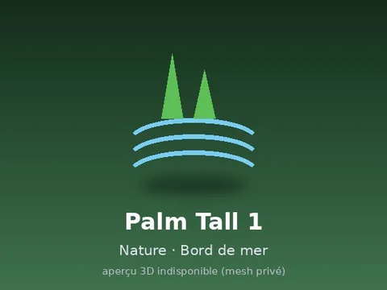 | [Palm Tall 1](Palm%20Tall%201.md) | Modèle en MeshParts · 1 MeshPart |
| 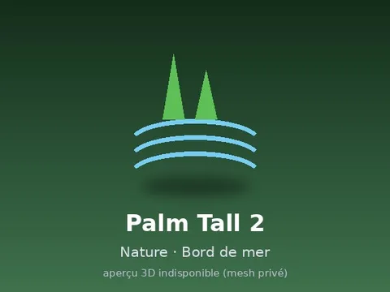 | [Palm Tall 2](Palm%20Tall%202.md) | Modèle en MeshParts · 1 MeshPart |
| 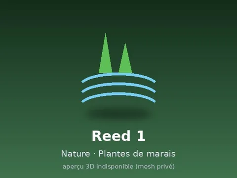 | [Reed 1](Reed%201.md) | Modèle en MeshParts · 1 MeshPart |
| 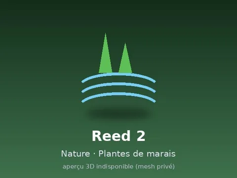 | [Reed 2](Reed%202.md) | Modèle en MeshParts · 1 MeshPart |
|  | [Reed 3](Reed%203.md) | Modèle en MeshParts · 1 MeshPart |
|  | [Reed 4](Reed%204.md) | Modèle en MeshParts · 1 MeshPart |
| 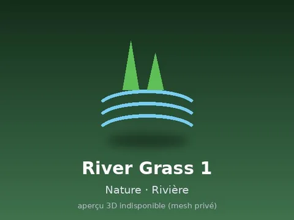 | [River Grass 1](River%20Grass%201.md) | Modèle en MeshParts · 1 MeshPart |
| 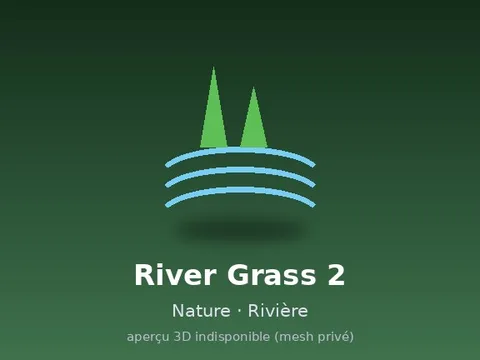 | [River Grass 2](River%20Grass%202.md) | Modèle en MeshParts · 1 MeshPart |
|  | [River Grass 3](River%20Grass%203.md) | Modèle en MeshParts · 1 MeshPart |
| 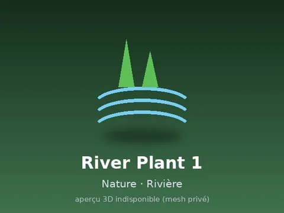 | [River Plant 1](River%20Plant%201.md) | Modèle en MeshParts · 1 MeshPart |
| 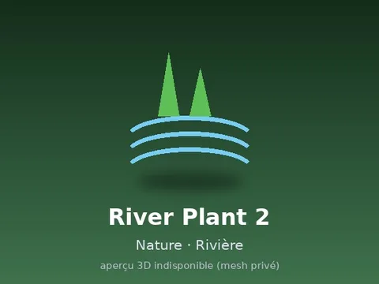 | [River Plant 2](River%20Plant%202.md) | Modèle en MeshParts · 1 MeshPart |
|  | [River Rock 1](River%20Rock%201.md) | Modèle en MeshParts · 1 MeshPart |
| 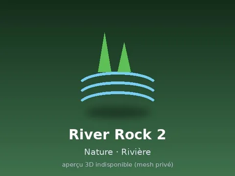 | [River Rock 2](River%20Rock%202.md) | Modèle en MeshParts · 1 MeshPart |
|  | [River Rock 3](River%20Rock%203.md) | Modèle en MeshParts · 1 MeshPart |
| 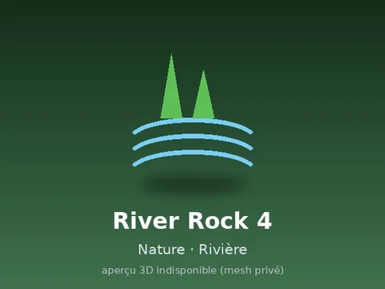 | [River Rock 4](River%20Rock%204.md) | Modèle en MeshParts · 1 MeshPart |
|  | [Shell Cluster 1](Shell%20Cluster%201.md) | Modèle en MeshParts · 1 MeshPart |
| 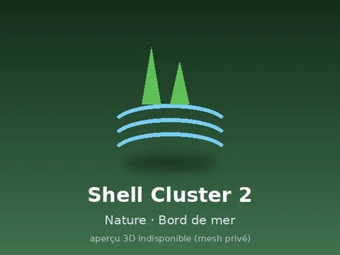 | [Shell Cluster 2](Shell%20Cluster%202.md) | Modèle en MeshParts · 1 MeshPart |
|  | [Swamp Grass 1](Swamp%20Grass%201.md) | Modèle en MeshParts · 1 MeshPart |
| 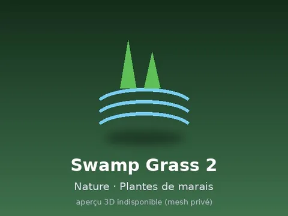 | [Swamp Grass 2](Swamp%20Grass%202.md) | Modèle en MeshParts · 1 MeshPart |
| 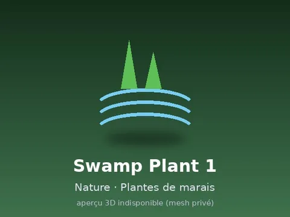 | [Swamp Plant 1](Swamp%20Plant%201.md) | Modèle en MeshParts · 1 MeshPart |
|  | [Swamp Plant 2](Swamp%20Plant%202.md) | Modèle en MeshParts · 1 MeshPart |
