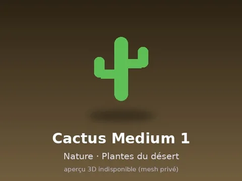

# Cactus Medium 1

Modèle en MeshParts « Cactus Medium 1 ». Pas d’aperçu 3D : mesh privé du compte LFT_Labs (le .rbxm marche quand même dans Studio connecté avec ce compte).

- **Catégorie** : [Pets & meshes](../Pets%20&%20meshes.md)
- **Sous-catégorie** : [Nature · Jungle, désert & champignons](Nature%20%C2%B7%20Jungle,%20d%C3%A9sert%20&%20champignons.md)
- **Type** : Modèle en MeshParts
- **Contenu** : 1 MeshPart
- **Pack d'origine** : Roblox Nature 480 (`600.rbxm`)
- **Fichier source** : `Assets/Nature 480/14 Plantes du désert/CACTUS_MEDIUM_01.rbxm` (dans le dossier Rake Vault, aussi téléchargeable depuis le vault 3D)
- **Meshes** : privés (compte Roblox LFT_Labs), pas d'aperçu 3D disponible
