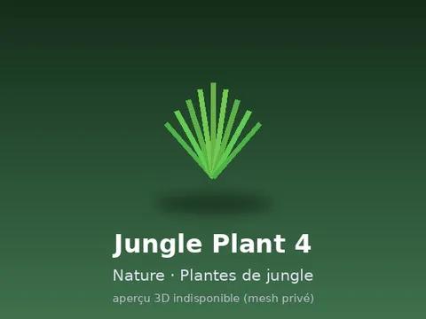

# Jungle Plant 4

Modèle en MeshParts « Jungle Plant 4 ». Pas d’aperçu 3D : mesh privé du compte LFT_Labs (le .rbxm marche quand même dans Studio connecté avec ce compte).

- **Catégorie** : [Pets & meshes](../Pets%20%26%20meshes.md)
- **Sous-catégorie** : [Nature · Jungle, désert & champignons](Nature%20%C2%B7%20Jungle%2C%20d%C3%A9sert%20%26%20champignons.md)
- **Type** : Modèle en MeshParts
- **Contenu** : 1 MeshPart
- **Pack d'origine** : Roblox Nature 480 (`600.rbxm`)
- **Fichier source** : `Assets/Nature 480/13 Plantes de jungle/JUNGLE_PLANT_04.rbxm` (dans le dossier Rake Vault, aussi téléchargeable depuis le vault 3D)
- **Meshes** : privés (compte Roblox LFT_Labs), pas d'aperçu 3D disponible
