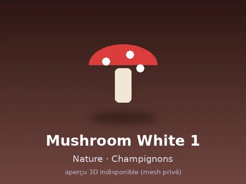

# Mushroom White 1

Modèle en MeshParts « Mushroom White 1 ». Pas d’aperçu 3D : mesh privé du compte LFT_Labs (le .rbxm marche quand même dans Studio connecté avec ce compte).

- **Catégorie** : [Pets & meshes](../Pets%20%26%20meshes.md)
- **Sous-catégorie** : [Nature · Jungle, désert & champignons](Nature%20%C2%B7%20Jungle%2C%20d%C3%A9sert%20%26%20champignons.md)
- **Type** : Modèle en MeshParts
- **Contenu** : 1 MeshPart
- **Pack d'origine** : Roblox Nature 480 (`600.rbxm`)
- **Fichier source** : `packs/Nature_480/19_MUSHROOMS/MUSHROOM_WHITE_01.rbxm` (export individuel, téléchargeable depuis le vault 3D)
- **Meshes** : privés (compte Roblox LFT_Labs), pas d'aperçu 3D disponible
