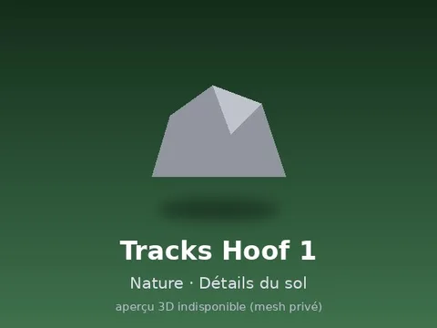

# Tracks Hoof 1

Modèle en MeshParts « Tracks Hoof 1 ». Pas d’aperçu 3D : mesh privé du compte LFT_Labs (le .rbxm marche quand même dans Studio connecté avec ce compte).

- **Catégorie** : [Pets & meshes](../Pets%20%26%20meshes.md)
- **Sous-catégorie** : [Nature · Rochers & sol](Nature%20%C2%B7%20Rochers%20%26%20sol.md)
- **Type** : Modèle en MeshParts
- **Contenu** : 1 MeshPart
- **Pack d'origine** : Roblox Nature 480 (`600.rbxm`)
- **Fichier source** : `packs/Nature_480/16_GROUND_DETAIL/TRACKS_HOOF_01.rbxm` (export individuel, téléchargeable depuis le vault 3D)
- **Meshes** : privés (compte Roblox LFT_Labs), pas d'aperçu 3D disponible
