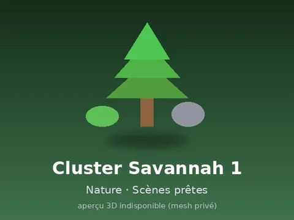

# Cluster Savannah 1

Modèle en MeshParts « Cluster Savannah 1 ». Pas d’aperçu 3D : mesh privé du compte LFT_Labs (le .rbxm marche quand même dans Studio connecté avec ce compte).

- **Catégorie** : [Pets & meshes](../Pets%20&%20meshes.md)
- **Sous-catégorie** : [Nature · Scènes prêtes](Nature%20%C2%B7%20Sc%C3%A8nes%20pr%C3%AAtes.md)
- **Type** : Modèle en MeshParts
- **Contenu** : 8 MeshParts
- **Pack d'origine** : Roblox Nature 480 (`600.rbxm`)
- **Fichier source** : `Assets/Nature 480/23 Scènes prêtes/CLUSTER_SAVANNAH_01.rbxm` (dans le dossier Rake Vault, aussi téléchargeable depuis le vault 3D)
- **Meshes** : privés (compte Roblox LFT_Labs), pas d'aperçu 3D disponible
