# Nature · Scènes prêtes

Sous-catégorie de [Pets & meshes](../Pets%20%26%20meshes.md) · **28 éléments**

| Aperçu | Élément | Infos |
| --- | --- | --- |
|  | [Cluster Autumn 1](Cluster%20Autumn%201.md) | Modèle en MeshParts · 6 MeshParts |
|  | [Cluster Autumn 2](Cluster%20Autumn%202.md) | Modèle en MeshParts · 6 MeshParts |
| 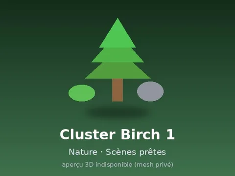 | [Cluster Birch 1](Cluster%20Birch%201.md) | Modèle en MeshParts · 6 MeshParts |
| 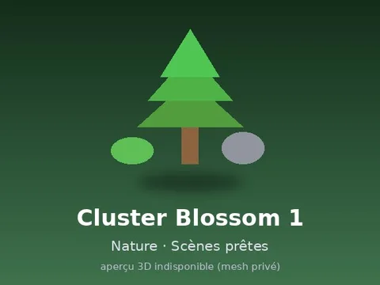 | [Cluster Blossom 1](Cluster%20Blossom%201.md) | Modèle en MeshParts · 6 MeshParts |
| 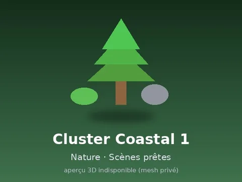 | [Cluster Coastal 1](Cluster%20Coastal%201.md) | Modèle en MeshParts · 6 MeshParts |
| 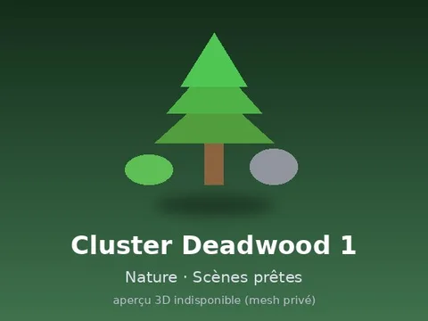 | [Cluster Deadwood 1](Cluster%20Deadwood%201.md) | Modèle en MeshParts · 8 MeshParts |
| 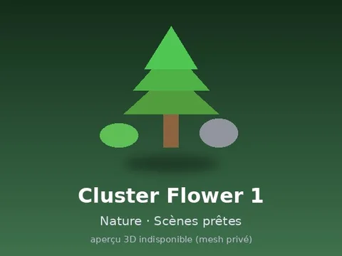 | [Cluster Flower 1](Cluster%20Flower%201.md) | Modèle en MeshParts · 7 MeshParts |
| 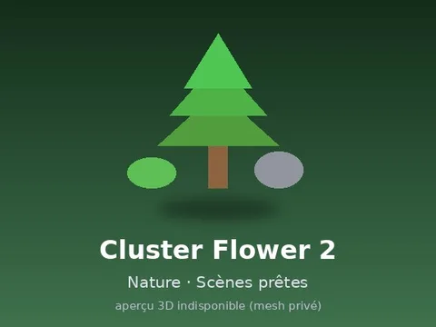 | [Cluster Flower 2](Cluster%20Flower%202.md) | Modèle en MeshParts · 7 MeshParts |
| 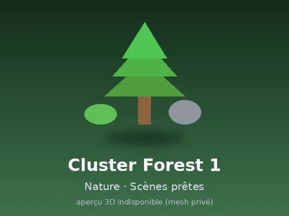 | [Cluster Forest 1](Cluster%20Forest%201.md) | Modèle en MeshParts · 9 MeshParts |
| 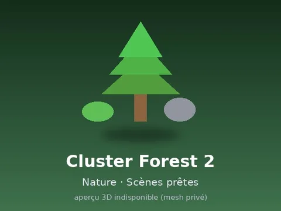 | [Cluster Forest 2](Cluster%20Forest%202.md) | Modèle en MeshParts · 9 MeshParts |
| 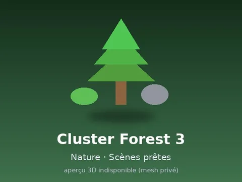 | [Cluster Forest 3](Cluster%20Forest%203.md) | Modèle en MeshParts · 9 MeshParts |
| 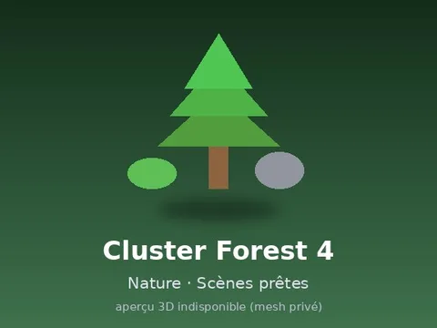 | [Cluster Forest 4](Cluster%20Forest%204.md) | Modèle en MeshParts · 9 MeshParts |
| 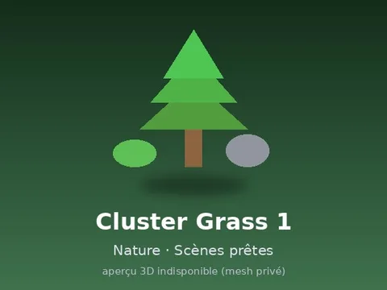 | [Cluster Grass 1](Cluster%20Grass%201.md) | Modèle en MeshParts · 7 MeshParts |
| 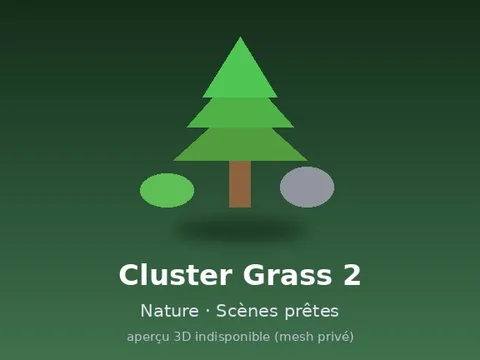 | [Cluster Grass 2](Cluster%20Grass%202.md) | Modèle en MeshParts · 7 MeshParts |
| 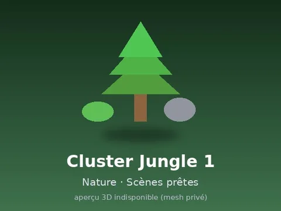 | [Cluster Jungle 1](Cluster%20Jungle%201.md) | Modèle en MeshParts · 8 MeshParts |
| 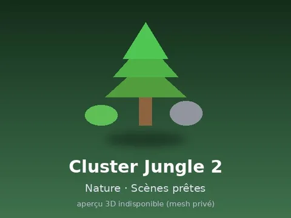 | [Cluster Jungle 2](Cluster%20Jungle%202.md) | Modèle en MeshParts · 8 MeshParts |
| 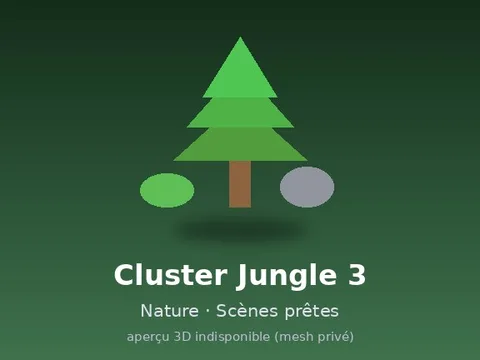 | [Cluster Jungle 3](Cluster%20Jungle%203.md) | Modèle en MeshParts · 8 MeshParts |
|  | [Cluster Riverbank 1](Cluster%20Riverbank%201.md) | Modèle en MeshParts · 8 MeshParts |
| 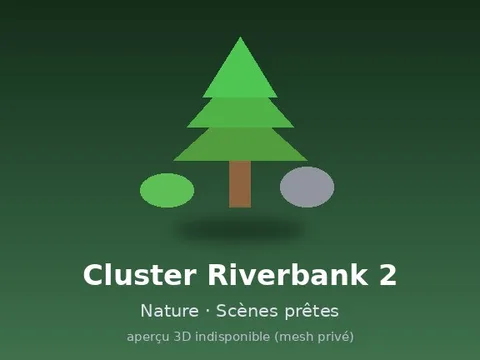 | [Cluster Riverbank 2](Cluster%20Riverbank%202.md) | Modèle en MeshParts · 8 MeshParts |
| 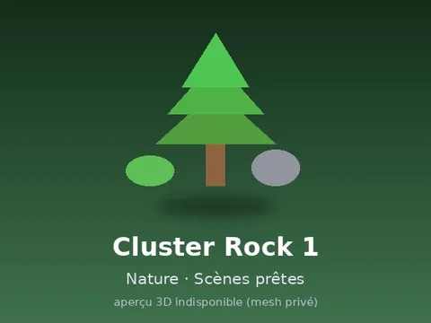 | [Cluster Rock 1](Cluster%20Rock%201.md) | Modèle en MeshParts · 7 MeshParts |
| 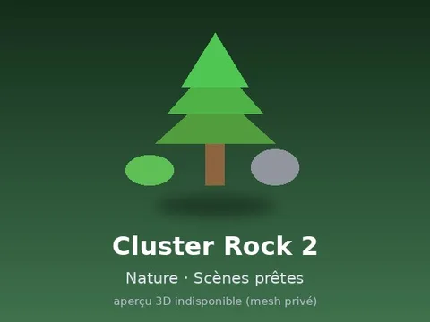 | [Cluster Rock 2](Cluster%20Rock%202.md) | Modèle en MeshParts · 7 MeshParts |
|  | [Cluster Rock 3](Cluster%20Rock%203.md) | Modèle en MeshParts · 7 MeshParts |
|  | [Cluster Savannah 1](Cluster%20Savannah%201.md) | Modèle en MeshParts · 8 MeshParts |
|  | [Cluster Savannah 2](Cluster%20Savannah%202.md) | Modèle en MeshParts · 8 MeshParts |
|  | [Cluster Savannah 3](Cluster%20Savannah%203.md) | Modèle en MeshParts · 8 MeshParts |
|  | [Cluster Snow 1](Cluster%20Snow%201.md) | Modèle en MeshParts · 6 MeshParts |
|  | [Cluster Snow 2](Cluster%20Snow%202.md) | Modèle en MeshParts · 6 MeshParts |
| 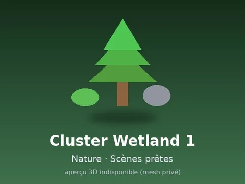 | [Cluster Wetland 1](Cluster%20Wetland%201.md) | Modèle en MeshParts · 6 MeshParts |
