# PNJ & personnages

Sous-catégorie de [Pets & meshes](../Pets%20%26%20meshes.md) · **30 éléments**

| Aperçu | Élément | Infos |
| --- | --- | --- |
| 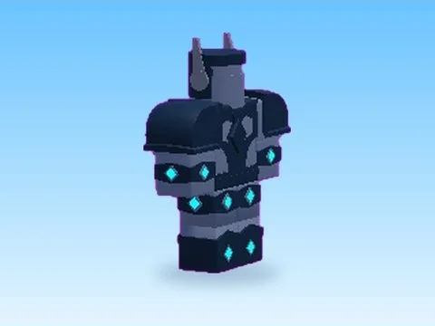 | [Boss · Robot Simulator](Boss%20%C2%B7%20Robot%20Simulator%20%C2%B7%20PNJ%20%26%20personnages.md) | Modèle en MeshParts · 63 MeshParts |
| 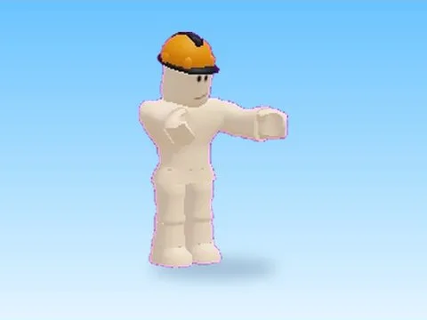 | [Builder · Robot Simulator](Builder%20%C2%B7%20Robot%20Simulator.md) | Modèle en MeshParts · 1 Part · 15 MeshParts |
| 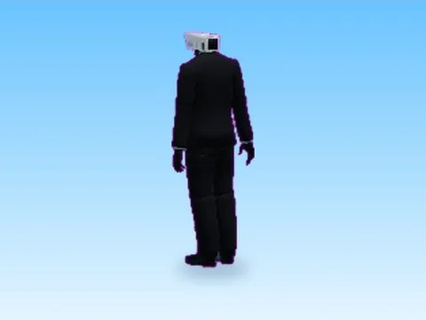 | [Camera Man · Training Simulator](Camera%20Man%20%C2%B7%20Training%20Simulator.md) | Modèle en MeshParts · 15 MeshParts |
| 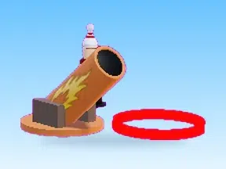 | [Cannon Guy · Tweeting Simulator](Cannon%20Guy%20%C2%B7%20Tweeting%20Simulator.md) | Modèle en MeshParts · 4 Parts · 18 MeshParts |
| 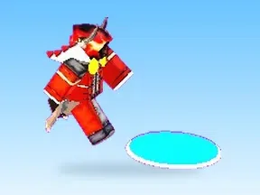 | [Devil · Cashgrab Bridge](Devil%20%C2%B7%20Cashgrab%20Bridge.md) | Modèle en MeshParts · 8 Parts · 3 MeshParts |
| 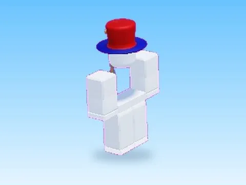 | [Dummy 2 · Bakery Simulator](Dummy%202%20%C2%B7%20Bakery%20Simulator.md) | Modèle en MeshParts · 1 Part · 16 MeshParts |
|  | [Dummy 3 · Bakery Simulator](Dummy%203%20%C2%B7%20Bakery%20Simulator.md) | Modèle en MeshParts · 1 Part · 15 MeshParts |
| 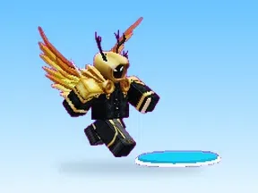 | [God · Cashgrab Bridge](God%20%C2%B7%20Cashgrab%20Bridge.md) | Modèle en MeshParts · 8 Parts · 4 MeshParts |
| 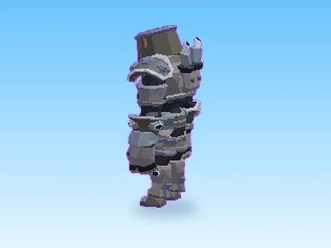 | [Mech Golem · Robot Simulator](Mech%20Golem%20%C2%B7%20Robot%20Simulator.md) | Modèle en MeshParts · 15 MeshParts |
| 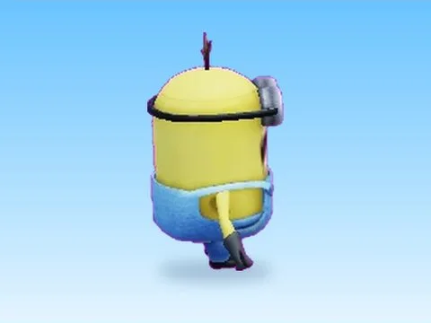 | [Minion · Robot Simulator](Minion%20%C2%B7%20Robot%20Simulator.md) | Modèle en MeshParts · 5 MeshParts |
| 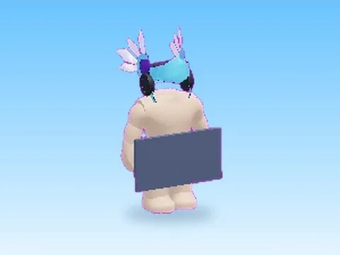 | [Mmistaken · Robot Simulator](Mmistaken%20%C2%B7%20Robot%20Simulator.md) | Modèle en MeshParts · 1 Part · 17 MeshParts |
| 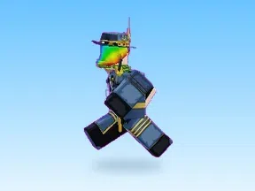 | [Mr Rich · Cashgrab Bridge](Mr%20Rich%20%C2%B7%20Cashgrab%20Bridge.md) | Modèle en MeshParts · 6 Parts · 5 MeshParts |
| 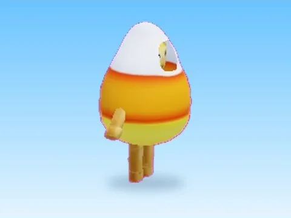 | [NPC · Hatching Simulator](NPC%20%C2%B7%20Hatching%20Simulator.md) | Modèle en MeshParts · 1 Part · 16 MeshParts |
| 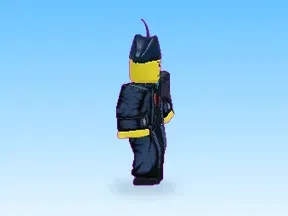 | [NPC · Pet Pharmica](NPC%20%C2%B7%20Pet%20Pharmica.md) | Modèle en MeshParts · 1 Part · 15 MeshParts |
| 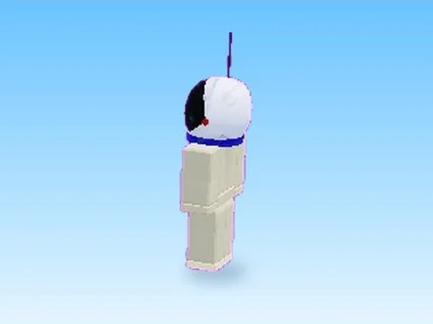 | [NPCS · Hatching Simulator](NPCS%20%C2%B7%20Hatching%20Simulator.md) | Modèle en MeshParts · 1 Part · 15 MeshParts |
| 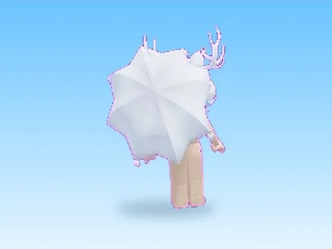 | [NPCS 5 · Hatching Simulator](NPCS%205%20%C2%B7%20Hatching%20Simulator.md) | Modèle en MeshParts · 1 Part · 22 MeshParts |
| 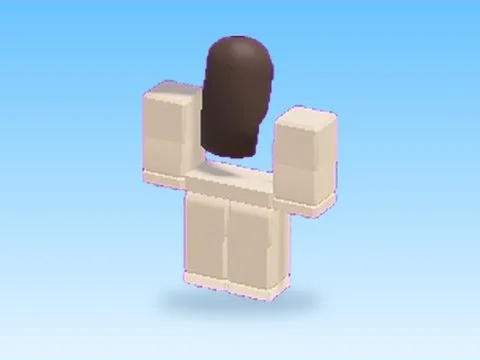 | [Npc Base · Bakery Simulator](Npc%20Base%20%C2%B7%20Bakery%20Simulator.md) | Modèle en MeshParts · 1 Part · 15 MeshParts |
| 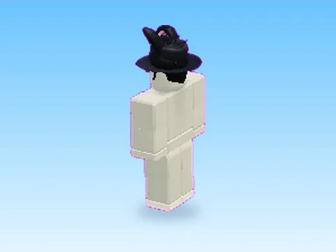 | [Npcs 2 · Hatching Simulator](Npcs%202%20%C2%B7%20Hatching%20Simulator.md) | Modèle en MeshParts · 1 Part · 18 MeshParts |
| 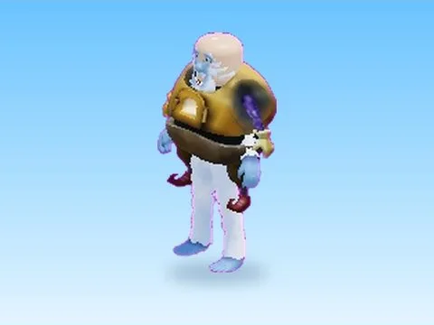 | [Npcs 3 · Hatching Simulator](Npcs%203%20%C2%B7%20Hatching%20Simulator.md) | Modèle en MeshParts · 1 Part · 15 MeshParts |
| 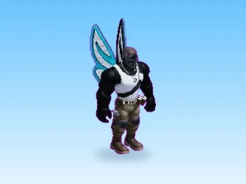 | [Npcs 4 · Hatching Simulator](Npcs%204%20%C2%B7%20Hatching%20Simulator.md) | Modèle en MeshParts · 18 MeshParts |
|  | [Owner · Cashgrab Bridge](Owner%20%C2%B7%20Cashgrab%20Bridge.md) | Modèle en MeshParts · 1 Part · 22 MeshParts |
| 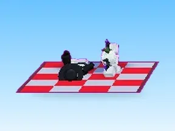 | [Picnic · First Donations](Picnic%20%C2%B7%20First%20Donations.md) | Modèle en MeshParts · 41 MeshParts |
| 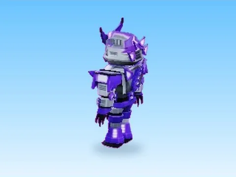 | [Purple Titan · Robot Simulator](Purple%20Titan%20%C2%B7%20Robot%20Simulator.md) | Modèle en MeshParts · 16 MeshParts |
| 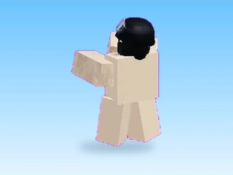 | [SWAT · Robot Simulator](SWAT%20%C2%B7%20Robot%20Simulator.md) | Modèle en MeshParts · 6 Parts · 23 MeshParts |
| 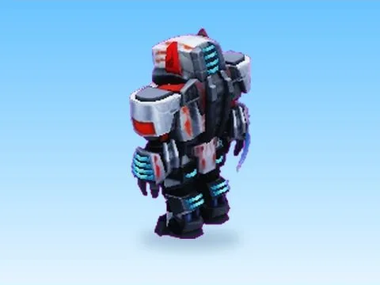 | [Super Robot · Robot Simulator](Super%20Robot%20%C2%B7%20Robot%20Simulator.md) | Modèle en MeshParts · 15 MeshParts |
| 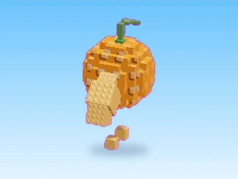 | [UDin Din Dun · Shoot A Brainrot](UDin%20Din%20Dun%20%C2%B7%20Shoot%20A%20Brainrot.md) | Modèle en MeshParts · 16 Parts · 17 MeshParts |
| 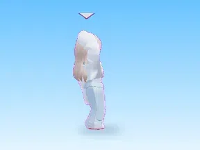 | [Unnamed · Cashgrab Bridge](Unnamed%20%C2%B7%20Cashgrab%20Bridge.md) | Modèle en MeshParts · 18 MeshParts |
| 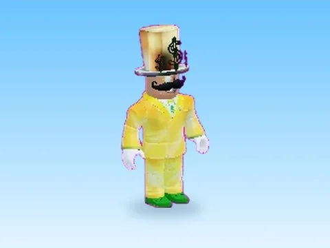 | [Unnamed · Glass Bridge](Unnamed%20%C2%B7%20Glass%20Bridge.md) | Modèle en MeshParts · 1 Part · 17 MeshParts |
| 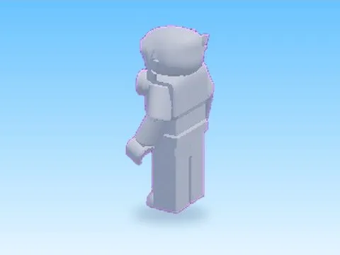 | [Unnamed · Robot Simulator](Unnamed%20%C2%B7%20Robot%20Simulator.md) | Modèle en MeshParts · 16 MeshParts |
| 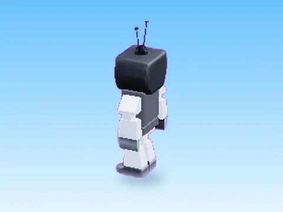 | [Ved · Robot Simulator](Ved%20%C2%B7%20Robot%20Simulator.md) | Modèle en MeshParts · 1 Part · 16 MeshParts |
