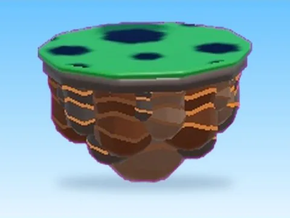
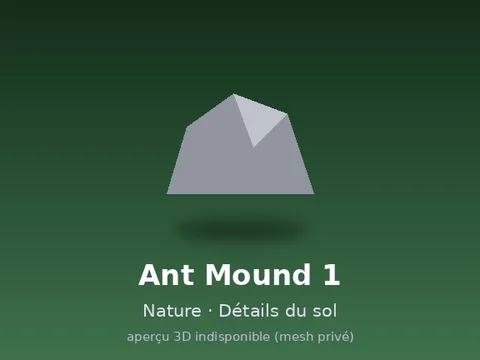
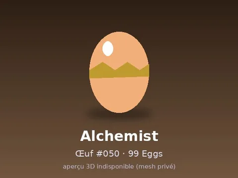
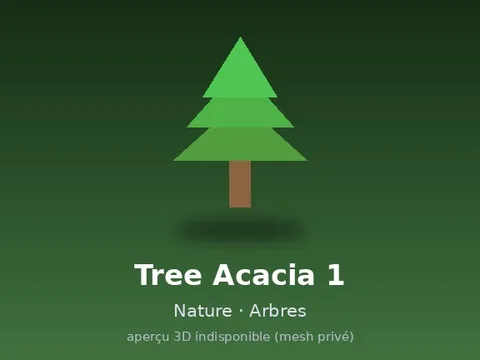
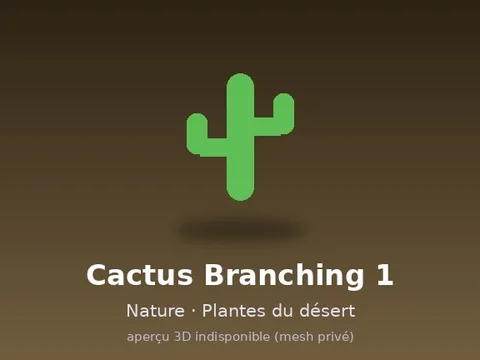
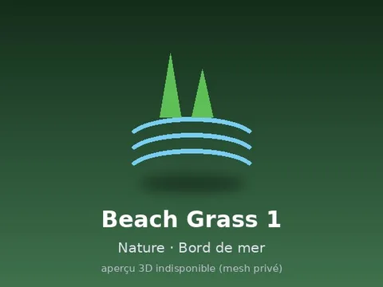
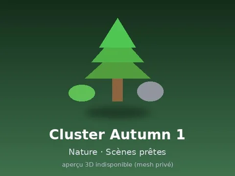

# Pets & meshes

**1250 éléments** répartis dans 25 sous-catégories

| Aperçu | Sous-catégorie | Éléments |
| --- | --- | --- |
|  | [Pets](Pets/Pets.md) | 203 |
|  | [Nature · Plantes & fleurs](Nature%20%C2%B7%20Plantes%20%26%20fleurs/Nature%20%C2%B7%20Plantes%20%26%20fleurs.md) | 136 |
|  | [Décor](D%C3%A9cor%20%28Pets%20%26%20meshes%29/D%C3%A9cor%20%28Pets%20%26%20meshes%29.md) | 122 |
|  | [Nature · Rochers & sol](Nature%20%C2%B7%20Rochers%20%26%20sol/Nature%20%C2%B7%20Rochers%20%26%20sol.md) | 106 |
|  | [99 Eggs](99%20Eggs/99%20Eggs.md) | 100 |
|  | [Brainrots animés](Brainrots%20anim%C3%A9s/Brainrots%20anim%C3%A9s.md) | 87 |
|  | [Nature · Arbres](Nature%20%C2%B7%20Arbres/Nature%20%C2%B7%20Arbres.md) | 72 |
|  | [Œufs & incubateurs](%C5%92ufs%20%26%20incubateurs%20%28Pets%20%26%20meshes%29/%C5%92ufs%20%26%20incubateurs%20%28Pets%20%26%20meshes%29.md) | 56 |
|  | [Nature · Jungle, désert & champignons](Nature%20%C2%B7%20Jungle%2C%20d%C3%A9sert%20%26%20champignons/Nature%20%C2%B7%20Jungle%2C%20d%C3%A9sert%20%26%20champignons.md) | 48 |
|  | [Nature · Eau & rivages](Nature%20%C2%B7%20Eau%20%26%20rivages/Nature%20%C2%B7%20Eau%20%26%20rivages.md) | 48 |
|  | [Nature · Bois & racines](Nature%20%C2%B7%20Bois%20%26%20racines/Nature%20%C2%B7%20Bois%20%26%20racines.md) | 42 |
|  | [Assets de jeux](Assets%20de%20jeux%20%28Pets%20%26%20meshes%29/Assets%20de%20jeux%20%28Pets%20%26%20meshes%29.md) | 36 |
|  | [PNJ & personnages](PNJ%20%26%20personnages%20%28Pets%20%26%20meshes%29/PNJ%20%26%20personnages%20%28Pets%20%26%20meshes%29.md) | 30 |
|  | [Nature · Scènes prêtes](Nature%20%C2%B7%20Sc%C3%A8nes%20pr%C3%AAtes/Nature%20%C2%B7%20Sc%C3%A8nes%20pr%C3%AAtes.md) | 28 |
|  | [Gadgets](Gadgets%20%28Pets%20%26%20meshes%29/Gadgets%20%28Pets%20%26%20meshes%29.md) | 20 |
|  | [Machines](Machines%20%28Pets%20%26%20meshes%29/Machines%20%28Pets%20%26%20meshes%29.md) | 20 |
|  | [Maps & îles](Maps%20%26%20%C3%AEles%20%28Pets%20%26%20meshes%29/Maps%20%26%20%C3%AEles%20%28Pets%20%26%20meshes%29.md) | 19 |
|  | [Chapeaux & accessoires](Chapeaux%20%26%20accessoires%20%28Pets%20%26%20meshes%29/Chapeaux%20%26%20accessoires%20%28Pets%20%26%20meshes%29.md) | 16 |
|  | [Coffres & collectibles](Coffres%20%26%20collectibles%20%28Pets%20%26%20meshes%29/Coffres%20%26%20collectibles%20%28Pets%20%26%20meshes%29.md) | 16 |
|  | [Leaderboards & panneaux](Leaderboards%20%26%20panneaux%20%28Pets%20%26%20meshes%29/Leaderboards%20%26%20panneaux%20%28Pets%20%26%20meshes%29.md) | 16 |
|  | [Bâtiments](B%C3%A2timents%20%28Pets%20%26%20meshes%29/B%C3%A2timents%20%28Pets%20%26%20meshes%29.md) | 14 |
|  | [Divers](Divers%20%28Pets%20%26%20meshes%29/Divers%20%28Pets%20%26%20meshes%29.md) | 8 |
|  | [Halloween](Halloween%20%28Pets%20%26%20meshes%29/Halloween%20%28Pets%20%26%20meshes%29.md) | 5 |
|  | [Tycoon & convoyeurs](Tycoon%20%26%20convoyeurs%20%28Pets%20%26%20meshes%29/Tycoon%20%26%20convoyeurs%20%28Pets%20%26%20meshes%29.md) | 1 |
|  | [Steal an Spooky Egg](Steal%20an%20Spooky%20Egg%20%28Pets%20%26%20meshes%29/Steal%20an%20Spooky%20Egg%20%28Pets%20%26%20meshes%29.md) | 1 |

Retour : [Rake Vault](../Rake%20Vault.md)
