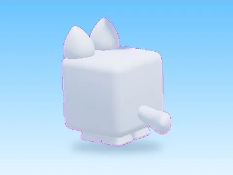

# Artic Cat · Mining Masters

Modèle en MeshParts « Artic Cat » (Mining Masters). Aperçu rendu dans Roblox Studio avec ses vraies textures.

- **Catégorie** : [Pets & meshes](../Pets%20&%20meshes.md)
- **Sous-catégorie** : [Pets](Pets.md)
- **Type** : Modèle en MeshParts
- **Contenu** : 10 MeshParts
- **Jeu d'origine** : Mining Masters
- **Fichier source** : `Assets/models/ByType/Pets/MiningMasters_ArticCat.rbxm` (dans le vault)
